<div align="center">
  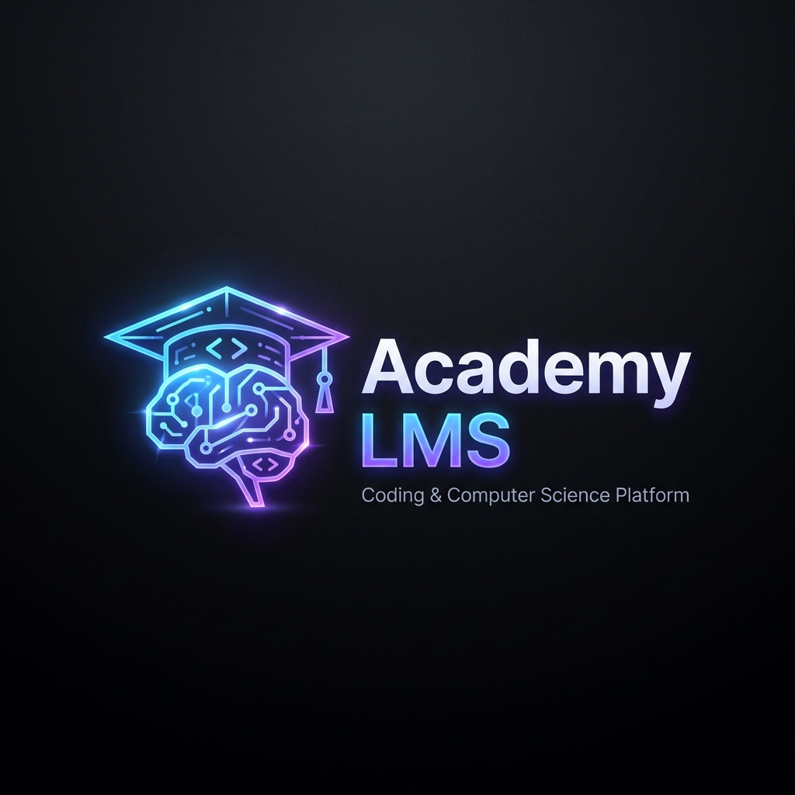
  <h1>Academy LMS</h1>
  <p><strong>The RGPV B.Tech study desk:</strong> five branches, semesters 1–8, one clean workspace.<br/>
  Notes · concept maps · MCQs · model papers · PDF handbooks · lectures · cloud sync.</p>

  <a href="https://academy-lms-sepia.vercel.app/"></a>
  <a href="https://github.com/Aryan-singh19/Academy-LMS/releases/latest"></a>
  <a href="LICENSE"></a>
  <br/>
  
  
  
  
  
  
  
  

  <br/><br/>
  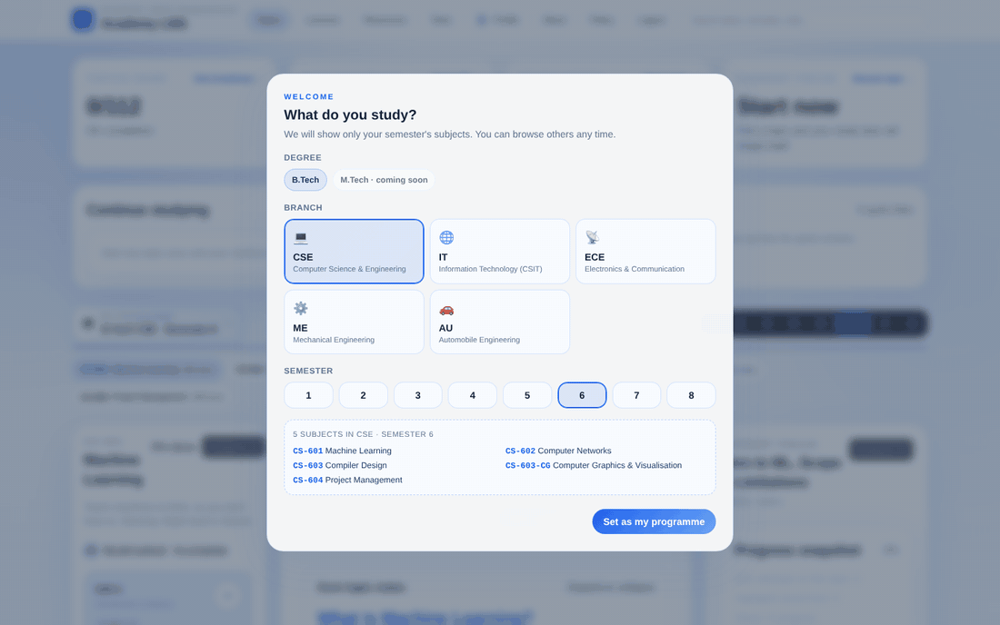
</div>

---

## Contents

| Use it | Understand it | Build on it |
|---|---|---|
| [What you get](#-what-you-get) | [Navigation model](#-navigation-that-keeps-you-in-your-semester) | [Run locally](#-run-locally) |
| [Coverage](#-coverage) | [Screenshots](#-screenshots) | [Docker](#-docker) |
| [Downloads (APK / EXE)](#-downloads-android--windows) | [Architecture](#-architecture) | [Deploy on Vercel + Neon](#-deploy-on-vercel--neon) |
| [Privacy](#-privacy) | [Project structure](#-project-structure) | [Add or edit subjects](#-add-or-edit-subjects) |
| | [CI/CD workflows](#-cicd-workflows) | [Roadmap](#-roadmap) · [Contributing](#-contributing) |

---

## ✨ What you get

- 🎓 **My Programme navigation.** Pick your branch and semester once. The desk, tests, resources, lectures and progress views then stay in your semester, and other semesters are one tap away in a clearly marked *Browsing* mode.
- 📚 **Topic pages at the CSE 6th sem standard**, with every topic containing:
  - core concepts and exam focus
  - a Mermaid concept map and a quick revision table
  - an in-depth explanation and an RGPV exam blueprint (2–3, 4 and 7 marks)
  - video lecture links and standard textbook references
- 📝 **Practice:** subject-wise drills, timed mocks, flashcards, a 60-second speed streak, an exam simulator, numerical trainers and protocol sandboxes. Every new topic adds 3 MCQs.
- 📄 **Downloadable material for every subject:**
  - unit-wise study notes (PDF)
  - an RGPV-pattern **model question paper** with two sets and answer hints (PDF)
  - a question bank with answers
- 🎬 **Lectures:** curated playlists for CSE 5–7, plus unit-wise lecture shelves for every other subject.
- ☁️ **Accounts and community:** Google sign-in, automatic cloud sync (Neon), topic comments, lecture-room chat, DMs, profiles, solved-PDF vault and an admin dashboard.
- 📱 **Everywhere:** responsive web app, Android APK, Windows installer/portable EXE and a Docker image.

## 🗺 Coverage

Subjects per semester (RGPV AICTE-flexible scheme; elective slots show the most commonly offered option):

| Branch | S1 | S2 | S3 | S4 | S5 | S6 | S7 | S8 |
|---|:-:|:-:|:-:|:-:|:-:|:-:|:-:|:-:|
| 💻 **CSE**: Computer Science & Engg. | 5 | 5 | 5 | 5 | 5 | 5 | 5 | 4 |
| 🌐 **IT**: Information Technology (CSIT) | 5 | 5 | 5 | 5 | 6 | 5 | 4 | 3 |
| 📡 **ECE**: Electronics & Communication | 5 | 5 | 5 | 5 | 4 | 4 | 4 | 3 |
| ⚙️ **ME**: Mechanical Engineering | 5 | 5 | 5 | 5 | 5 | 4 | 4 | 3 |
| 🚗 **AU**: Automobile Engineering | 5 | 5 | 5 | 5 | 5 | 4 | 4 | 3 |
| ⚡ **EX**: Electrical & Electronics | 5 | 5 | 5 | 5 | 4 | 4 | 4 | 3 |
| 🏗️ **CE**: Civil Engineering | 5 | 5 | 5 | 5 | 4 | 4 | 4 | 4 |

**M.Tech** (theory semesters 1–2; semesters 3–4 are electives and dissertation):

| Specialisation | S1 | S2 |
|---|:-:|:-:|
| 🧠 Computer Science & Engg. (MCSE) | 4 | 4 |
| 🔬 VLSI Design (MVL) | 4 | 4 |
| 🔥 Thermal Engineering (MTH) | 4 | 4 |
| 🏛️ Structural Engineering (MST) | 4 | 4 |
| 🔌 Power Systems (MPS) | 4 | 4 |

Every M.Tech programme includes Research Methodology & IPR in semester 2.

<details>
<summary><b>Full subject list per branch</b> (click to expand)</summary>

**First year (all branches):**
- BT-101 Engineering Chemistry
- BT-102 Mathematics-I
- BT-103 English for Communication
- BT-104 Basic Electrical & Electronics Engg.
- BT-105 Engineering Graphics
- BT-201 Engineering Physics
- BT-202 Mathematics-II
- BT-203 Basic Mechanical Engg.
- BT-204 Basic Civil Engg. & Mechanics
- BT-205 Basic Computer Engg.

**CSE:**
- **S3:** ES-301 Energy & Environmental Engg., CS-302 Discrete Structure, CS-303 Data Structure, CS-304 Digital Systems, CS-305 OOPM
- **S4:** BT-401 Mathematics-III, CS-402 ADA, CS-403 Software Engg., CS-404 COA, CS-405 Operating Systems
- **S5:** CS-501 TOC, CS-502 DBMS, CS-503 Data Analytics, CS-503 Cyber Security, CS-504 Web Technology
- **S6:** CS-601 ML, CS-602 Computer Networks, CS-603 Compiler Design, CS-603 Computer Graphics, CS-604 Project Management
- **S7:** CS-701 Software Architectures, CS-702 Big Data / Wireless & Mobile Computing, CS-703 Cryptography / Disaster Management
- **S8:** CS-801 IoT, CS-802(A) Blockchain, CS-802(B) Cloud Computing, CS-803(A) Image Processing & Computer Vision

**IT (CSIT):**
- **S3:** shared with CSE S3
- **S4:** BT-401, CSIT-402 Analog & Digital Communication, CSIT-403 ADA, CSIT-404 COA, CSIT-405 DBMS
- **S5:** CSIT-501 Computer Networking, CSIT-502 OS, CSIT-503(A) TOC, CSIT-504(A) Cyber Security, CSIT-504(B) AI, CSIT-504(C) Web Tech
- **S6:** CSIT-601 Software Engg. & Agile, CSIT-602 ML, CSIT-603(A) WMC, CSIT-603(B) Computer Graphics, CSIT-604(A) Cryptography & Network Security
- **S7:** CSIT-701 IoT, CSIT-702(B) Compiler Design, CSIT-702(D) NLP, CSIT-703(C) Cloud Computing
- **S8:** CSIT-801 Data Science, CSIT-802(A) Data Warehousing & Mining, CSIT-802(D) Blockchain

**ECE:**
- **S3:** BT-301 Mathematics-III, EC-302 Electronic Measurement & Instrumentation, EC-303 Digital System Design, EC-304 Electronic Devices, EC-305 Network Analysis
- **S4:** ES-401, EC-402 Signals & Systems, EC-403 Analog Communication, EC-404 Control System, EC-405 Analog Circuits
- **S5:** EC-501 Microprocessor & Applications, EC-502 Digital Communication, EC-503(B) Mobile Communication, EC-504(A) EMT
- **S6:** EC-601 DSP, EC-602 Antennas & Wave Propagation, EC-603(C) Satellite Communication, EC-604(A) Microcontroller & Embedded Systems
- **S7:** EC-701 VLSI Design, EC-702(A) Microwave Engg., EC-702(B) Information Theory & Coding, EC-703(B) IoT
- **S8:** EC-801 Optical Fibre Communication, EC-802(B) Wireless Communication, EC-803(B) Digital Image Processing

**ME:**
- **S3:** BT-301, ME-302 Thermodynamics, ME-303 Materials Technology, ME-304 Strength of Materials, ME-305 Manufacturing Process
- **S4:** ES-401, ME-402 Instrumentation & Control, ME-403 Theory of Machines, ME-404 Fluid Mechanics, ME-405 Manufacturing Technology
- **S5:** ME-501 IC Engines, ME-502 Mechanical Vibrations, ME-503(A) Mechatronics, ME-503(C) Alternate Automotive Fuels, ME-504(C) FEM
- **S6:** ME-601 Thermal Engg. & Gas Dynamics, ME-602 Machine Component Design, ME-603(A) Turbo Machinery, ME-604(A) Robotics
- **S7:** ME-701 Heat & Mass Transfer, ME-702(C) Power Plant Engg., ME-702(B) IoT, ME-703(A) OR & Supply Chain
- **S8:** ME-801 Refrigeration & Air Conditioning, ME-802(A) Automobile Engg., ME-803(B) Energy Conservation & Audit

**AU:**
- **S3–S4:** shared with ME
- **S5:** AU-501 Automotive Engines, AU-502 Automotive Chassis, AU-503(A) Automotive Transmission, AU-503(C) Alternate Fuels & Emissions, AU-504(C) Mechatronics
- **S6:** AU-601 Automotive Electrical & Electronics, AU-602 Machine Component Design, AU-603 Vehicle Dynamics, AU-604 Robotics
- **S7:** AU-701 Mechanical Vibration, AU-702 Heat & Mass Transfer, AU-703 Vehicle Body Engg. & Aerodynamics, AU-704 Electric & Hybrid Vehicles
- **S8:** AU-801 Vehicle Maintenance & Fault Diagnosis, AU-802 Automotive Safety & Legislation, AU-803 Refrigeration & Air Conditioning

**EX:**
- **S3:** ES-301, EX-302 Electronic Devices, EX-303 Electrical Measurements & Instrumentation, EX-304 Network Analysis, EX-305 Signals & Systems
- **S4:** BT-401, EX-402 Electrical Machines-I, EX-403 Digital Electronics, EX-404 Power Systems-I, EX-405 Control Systems
- **S5:** EX-501 Electrical Machines-II, EX-502 Power Electronics, EX-503(C) Renewable Power Generation, EX-504(A) Industrial Electronics
- **S6:** EX-601 Power Systems-II, EX-602 Microprocessors, EX-603(A) Utilization of Electrical Energy, EX-604(B) IoT
- **S7:** EX-701 Power System Protection, EX-702(B) HVDC & FACTS, EX-702(C) High Voltage Engg., EX-703(A) Electric & Hybrid Vehicles
- **S8:** EX-801 Electrical Drives, EX-802(B) Special Electrical Machines, EX-802(D) Artificial Intelligence

**CE:**
- **S3:** BT-301, CE-302 Construction Materials, CE-303 Surveying, CE-304 Building Planning & Architecture, CE-305 Strength of Materials
- **S4:** ES-401, CE-402 Construction Technology, CE-403 Structural Analysis-I, CE-404 Transportation Engg.-I, CE-405 Engg. Geology & Remote Sensing
- **S5:** CE-501 Fluid Mechanics, CE-502 Transportation Engg.-II, CE-503(A) Structural Analysis-II, CE-504(B) Remote Sensing & GIS
- **S6:** CE-601 RCC Design, CE-602 Environmental Engg.-I, CE-603(A) Water Resource Engg., CE-604(D) Operations Research
- **S7:** CE-701 Geotechnical Engg., CE-702(A) Prestressed Concrete, CE-702(B) Environmental Engg.-II, CE-703(A) IoT
- **S8:** CE-801 Steel Structures, CE-802(B) Foundation Engg., CE-802(D) Earthquake Resistant Design, CE-803(B) Data Analytics

**M.Tech:**
- **CSE:** Adv. Computational Maths, Adv. Data Structures & Algorithms, Adv. Computer Architecture, Adv. Computer Networks · Adv. Machine Learning, Distributed Systems & Cloud, Adv. Information Security, Research Methodology & IPR
- **VLSI:** Digital IC Design, Analog IC Design, VLSI Technology & Fabrication, Adv. Digital System Design & Verification · Low Power VLSI, VLSI Testing & Testability, SoC & Embedded Design, Research Methodology & IPR
- **Thermal:** Adv. Thermodynamics, Adv. Fluid Mechanics, Adv. Heat & Mass Transfer, CFD · Design of Thermal Systems, Adv. IC Engines & Emissions, Adv. Refrigeration & Cryogenics, Research Methodology & IPR
- **Structural:** Adv. Structural Analysis, Elasticity & Plasticity, Adv. Concrete Technology, Structural Dynamics · Adv. Steel Design, FEM, Earthquake Resistant Design, Research Methodology & IPR
- **Power Systems:** Adv. Power System Analysis, Dynamics & Stability, Adv. Power Electronic Converters, Optimisation Techniques · Operation & Control, Smart Grid, HVDC & FACTS, Research Methodology & IPR

> M.Tech paper codes differ slightly between RGPV institutes; the subjects follow the common RGPV M.Tech schemes.
> AU semesters 6–8 follow the commonly offered RGPV papers. Confirm elective codes with your department and the [official RGPV syllabus portal](https://www.rgpv.ac.in).
</details>

Shared papers (for example *Data Structure* for CSE and IT, or *Thermodynamics* for ME and AU) are one subject internally. Your progress counts in both branches, and each branch still sees its own paper code.

## 🧭 Navigation that keeps you in your semester

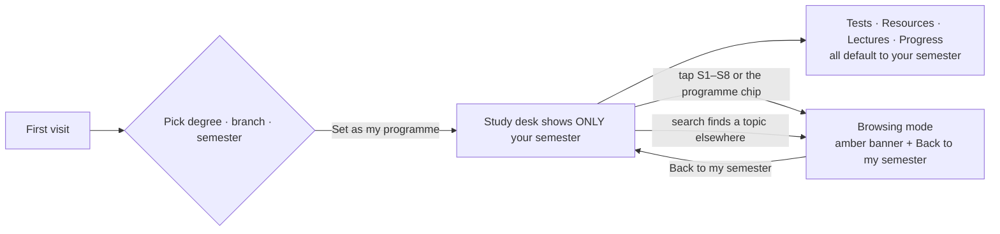

- The **programme chip** (for example `⚙️ B.Tech ME · Semester 4`) opens the picker at any time.
- **Semester tabs S1–S8** mark your own semester with ★.
- **Browsing** another branch or semester never changes your saved programme.
- Each branch gets its own subtle accent colour. Layout and components stay identical to the original CSE 5–7 design.

## 📸 Screenshots

| Pick your programme | Your semester only |
|---|---|
| 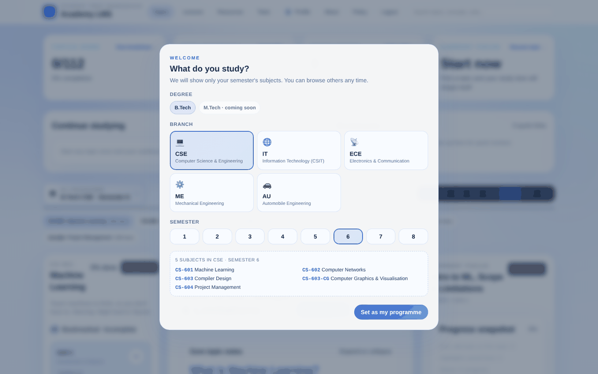 | 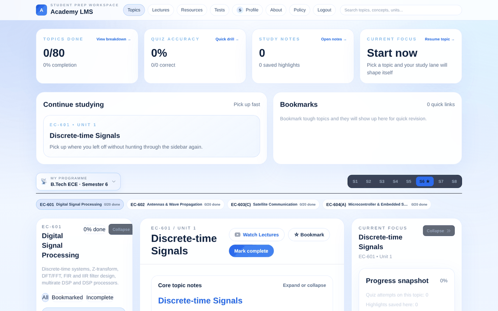 |
| **Browsing another semester (clearly marked)** | **Topic page** |
| 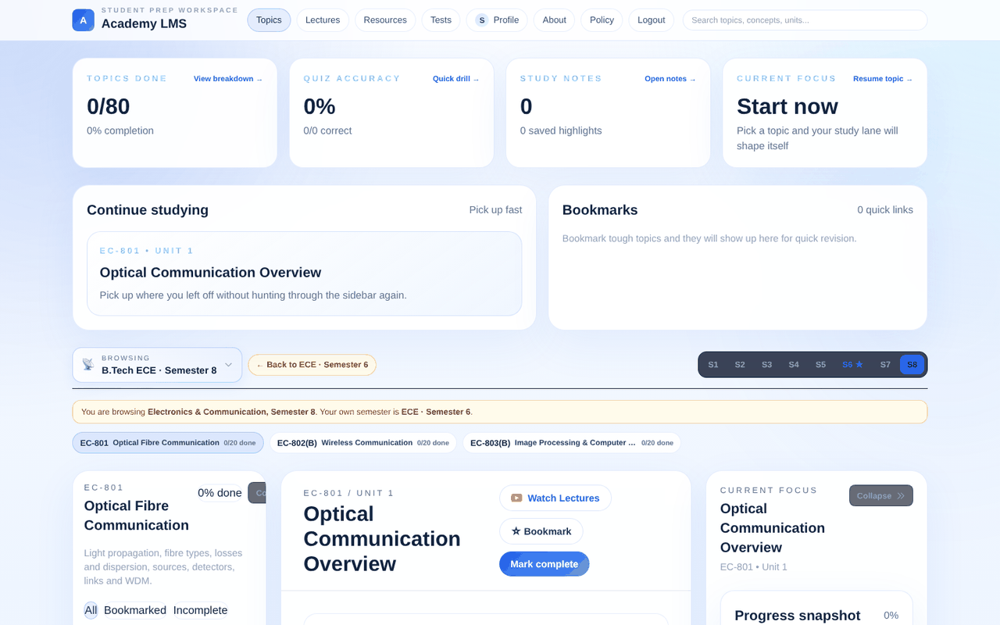 | 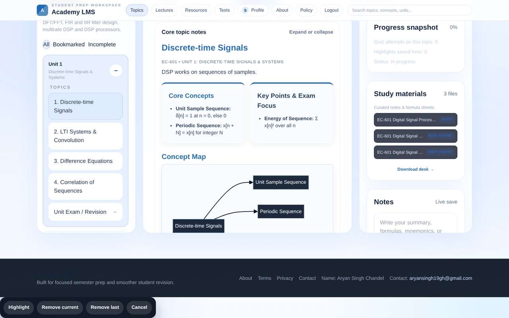 |
| **Explanation, exam blueprint and concept map** | **Built-in MCQs per topic** |
| 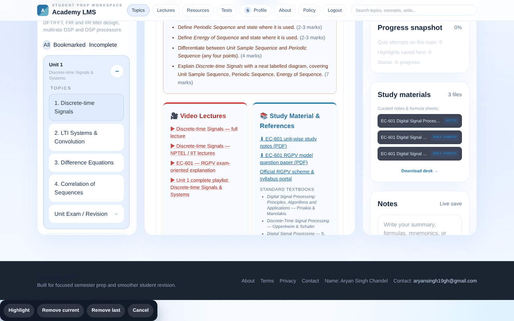 | 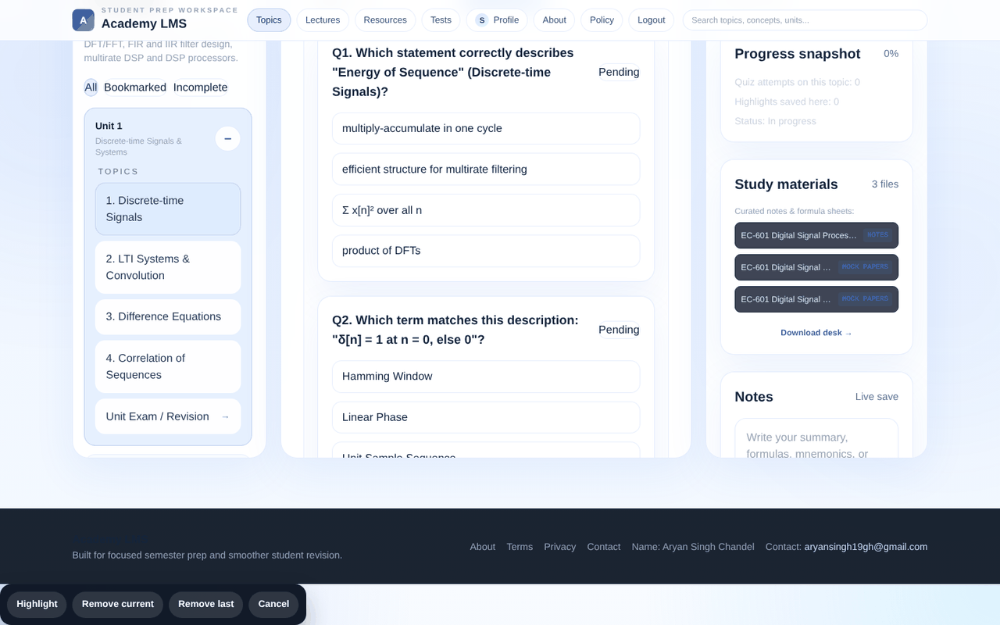 |
| **Practice tests by branch and semester** | **Resources: notes, model papers, question banks** |
| 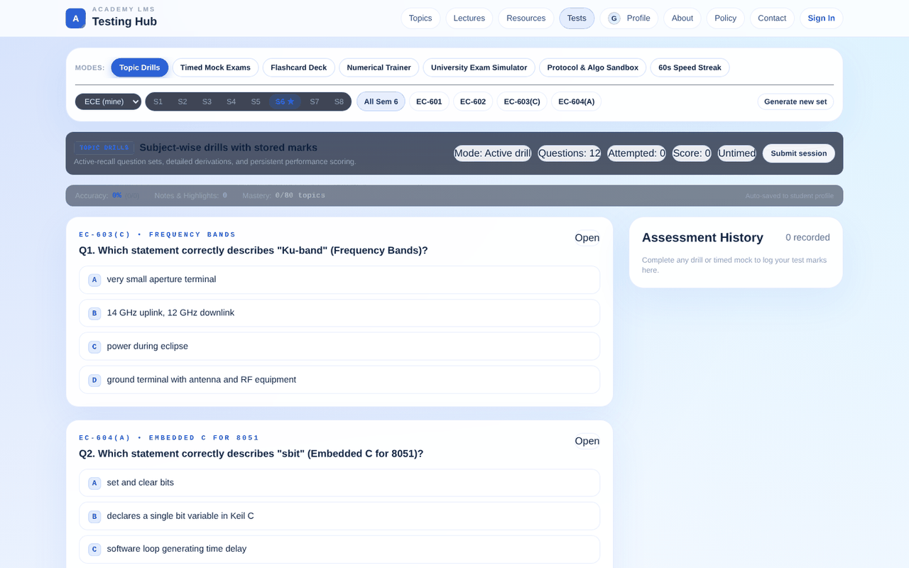 | 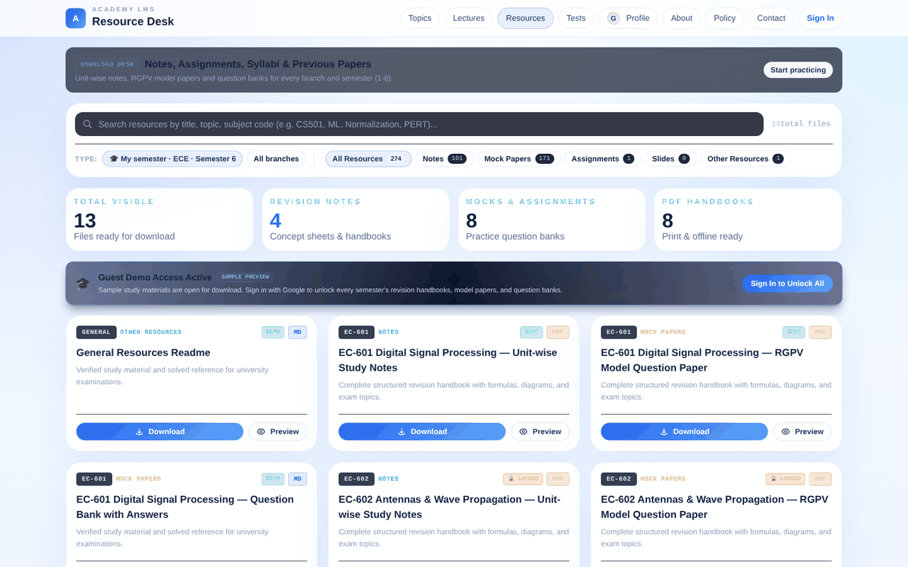 |
| **Lectures: curated plus unit-wise shelves** | **Mobile** |
| 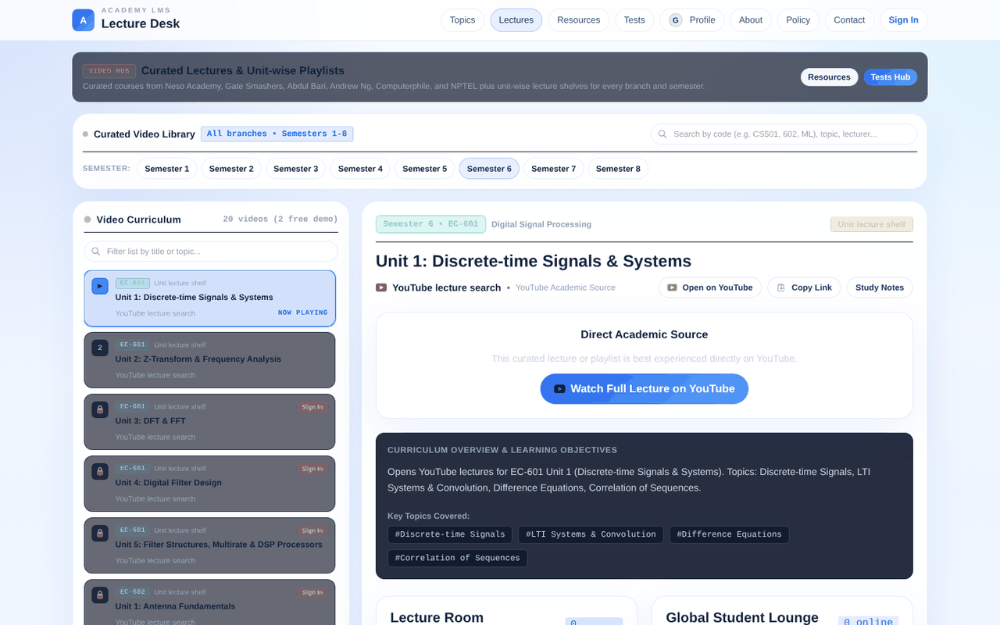 | 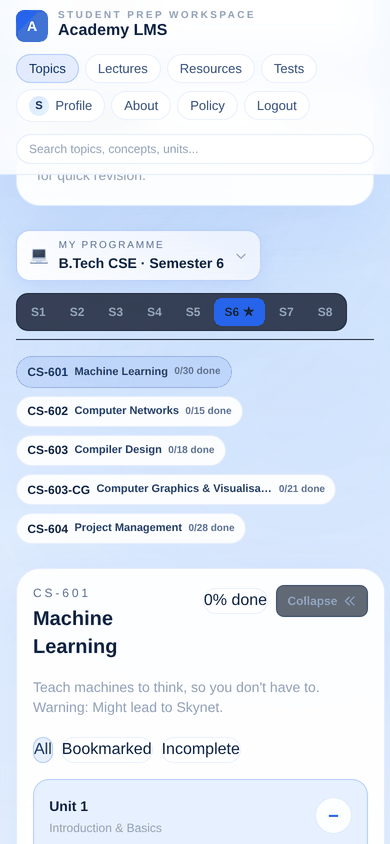 |

## 📦 Downloads (Android & Windows)

Grab the latest build from **[Releases](https://github.com/Aryan-singh19/Academy-LMS/releases/latest)**:

| File | Platform | Notes |
|---|---|---|
| `Academy-LMS-vX.Y.Z.apk` | Android 7.0+ | Allow "Install unknown apps" for your browser or file manager |
| `Academy-LMS-Setup-X.Y.Z.exe` | Windows 10/11 | Installer with a choice of install folder |
| `Academy-LMS-Portable-X.Y.Z.exe` | Windows 10/11 | Runs without installing |

The apps open the live desk (sign-in, sync, chat). The Windows app falls back to a bundled offline copy when there is no internet. The EXE is not code-signed yet, so on SmartScreen choose **More info → Run anyway**.

## 🏗 Architecture

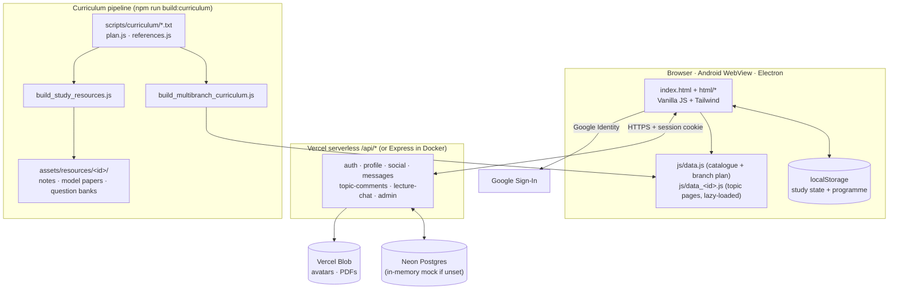

## 🚀 Run locally

```bash
git clone https://github.com/Aryan-singh19/Academy-LMS.git
cd Academy-LMS
npm install
npm run dev          # Express server with /api routes → http://localhost:3000
```

Static-only preview, with no API, cloud sync or chat:

```bash
python -m http.server 8000    # → http://localhost:8000
```

Without `DATABASE_URL` the API uses an in-memory mock store, which is fine for local study and demos.

## 🐳 Docker

```bash
docker compose up --build            # → http://localhost:3000
# or
docker build -t academy-lms .
docker run --rm -p 3000:3000 --env-file .env academy-lms
```

Prebuilt images are published to GHCR by the Docker workflow:

```bash
docker pull ghcr.io/aryan-singh19/academy-lms:main
```

| Variable | Purpose |
|---|---|
| `DATABASE_URL` / `POSTGRES_URL` | Neon connection string (optional; mock store if empty) |
| `GOOGLE_CLIENT_ID` | Enables Google sign-in |
| `ADMIN_SECRET`, `ADMIN_EMAILS` | Admin dashboard access |
| `BLOB_READ_WRITE_TOKEN` | Avatar and solved-PDF uploads (Vercel Blob) |
| `PORT` | Server port (default `3000`) |

## ☁️ Deploy on Vercel + Neon

1. Import the repo in Vercel (no build step needed; `vercel.json` serves the repo root).
2. Set `DATABASE_URL`, `GOOGLE_CLIENT_ID` and `ADMIN_SECRET`, plus optional `ADMIN_EMAILS` and `BLOB_READ_WRITE_TOKEN`.
3. Apply [`docs/academy_schema.sql`](docs/academy_schema.sql) to Neon.
4. Deploy. Details are in [`docs/vercel-neon-setup.md`](docs/vercel-neon-setup.md).

API routes: `app-config`, `auth-google`, `auth-session`, `auth-logout`, `profile`, `social`, `messages`, `topic-comments`, `lecture-chat`, `blob-upload`, `report-user` and `admin`.

## 🗂 Project structure

```
├── index.html                 # Study desk (topics, notes, quizzes, progress)
├── html/                      # tests · lectures · resources · profile · about · privacy · terms
├── admin/                     # Admin dashboard (leaderboard, inspection, moderation)
├── js/
│   ├── data.js                # Course catalogue + generated branch plan (window.branchPlan)
│   ├── data_<id>.js           # Topic pages + MCQs per subject (lazy-loaded)
│   ├── shared.js              # State, sync, stats, programme API (getProgram/setProgram/...)
│   ├── app.js                 # Study desk + programme picker + browsing mode
│   ├── tests.js · lectures.js · resources.js · profile.js
│   └── resource-library.js    # Download catalogue (curated + generated block)
├── assets/resources/<id>/     # notes/*.pdf|md · mock-papers/*.pdf|md
├── api/                       # Vercel serverless functions (+ _lib: db, auth, rate limit, mock db)
├── scripts/
│   ├── curriculum/            # ✏️ syllabus sources (*.txt), plan.js, references.js
│   ├── build_multibranch_curriculum.js
│   └── build_study_resources.js
├── android/                   # WebView app (APK)
├── desktop/                   # Electron app (Windows EXE, offline fallback)
├── Dockerfile · docker-compose.yml
└── .github/workflows/         # CI, release (APK + EXE), Docker, curriculum check
```

## ✏️ Add or edit subjects

Every generated subject comes from a short text source in `scripts/curriculum/`:

```text
@ me404 | ME-404 | Fluid Mechanics | Fluid properties, statics, kinematics, dynamics ...
# Fluid Properties & Statics
- Properties of Fluids | Fluids deform continuously under shear. | Viscosity = resistance to shear; τ = μ du/dy | Newtonian Fluid = ...
```

- `@` starts a subject (`id | code | title | description`), `#` starts a unit, and `-` adds a topic: `title | overview | Term = definition | …`.
- Add the subject to a branch and semester in [`scripts/curriculum/plan.js`](scripts/curriculum/plan.js), and add textbooks in [`references.js`](scripts/curriculum/references.js).
- Rebuild everything (topic pages, MCQs, PDFs and the resource catalogue):

```bash
npm run build:curriculum
```

The *Curriculum build check* workflow fails a PR if generated files are stale.

## ⚙️ CI/CD workflows

| Workflow | Trigger | What it does |
|---|---|---|
| `static-site-checks.yml` | push / PR | HTML validation, JS syntax and formatting |
| `curriculum.yml` | changes in `scripts/` or `js/data*` | Rebuilds the curriculum and fails if output is stale |
| `build-apk.yml` | Android changes | Builds the APK as a CI artifact |
| `release.yml` | tag `v*` or manual | Builds the **APK** and **Windows installer + portable EXE** and attaches them to a GitHub Release |
| `docker.yml` | push / tag / PR | Builds the image and pushes it to GHCR (not on PRs) |
| `organize-resources.yml` | push to main | Files new uploads into `assets/resources` and updates the catalogue |
| `link-check.yml` | schedule | Checks for broken links |

Cut a release:

```bash
git tag v2.0.0 && git push origin v2.0.0
```

## 🛣 Roadmap

- [x] CSE semesters 5–7 with rich notes, quizzes and the practice suite
- [x] **v2.0**: CSE, IT, ECE, ME and AU semesters 1–8 · My Programme navigation · PDFs · model papers · APK + EXE releases · Docker
- [x] **v2.1**: Civil (CE) and Electrical (EX) semesters 1–8 · M.Tech CSE, VLSI, Thermal, Structural and Power Systems · safe programme switching with recent programmes
- [x] **v2.2**: offline Android app · Android 16 target · Play Store launch kit ([docs/play-store](docs/play-store/README.md))
- [ ] Google Play release (closed test with 12+ testers first)
- [ ] More M.Tech specialisations (Communication, Production, Environmental, Data Science)
- [ ] Hand-curated YouTube playlists for every new subject
- [ ] Solved numericals and branch-specific trainers (thermo cycles, beam SFD/BMD, DSP filters)
- [ ] Previous-year question links per subject
- [ ] Offline-first PWA with background sync
- [ ] Signed Windows build and Play Store listing

Suggestions are welcome as [issues](https://github.com/Aryan-singh19/Academy-LMS/issues).

## 🤝 Contributing

1. Fork, create a branch, and make your change (for syllabus content, edit `scripts/curriculum/*.txt`).
2. Run `npm run build:curriculum` and `npm run check:js`.
3. Open a PR describing the subject or semester you touched.

If you spot a wrong code, unit or definition, opening an issue is enough.

## 🔒 Privacy

Local-first, with no ads or trackers; sign-in is optional. See **[PRIVACY.md](PRIVACY.md)** (in-app: [`html/privacy.html`](html/privacy.html)).

> Generated model papers are practice material, not official RGPV papers. Always confirm your scheme on [rgpv.ac.in](https://www.rgpv.ac.in).

## 📄 License

[MIT](LICENSE) © 2026 Aryan Singh Chandel · Changes are listed in [CHANGELOG.md](CHANGELOG.md).
