# Preface {.unnumbered}

This document records how Academy LMS came to exist, how it was built, what went wrong along the way, and what it has become. It is written for three kinds of reader. The first is a student who uses the site and wants to know why it behaves the way it does. The second is a developer who wants to add a branch, fix a page or run the project on their own machine, and needs to understand the decisions behind the code before touching it. The third is me, a year from now, when I have forgotten why the curriculum lives in plain text files or why the study desk refuses to show subjects from another semester unless you ask it to.

Academy LMS is a study portal for students of Rajiv Gandhi Proudyogiki Vishwavidyalaya (RGPV), the technical university of Madhya Pradesh. A student picks a degree, a branch and a semester once, and the site shows only that semester's subjects. Every subject is broken into units and topics, and every topic has a written explanation, a concept map, a revision table, an exam blueprint for the two-, four- and seven-mark questions RGPV likes to ask, links to lectures and textbooks, and a short quiz. Around that core sit a practice-test hub, a lecture library, a resource library of notes PDFs and model papers, a profile page with progress and an exportable snapshot, and an optional community layer for comments, lecture-room chat and direct messages. It runs as a static site with a handful of serverless functions, and ships as an Android app and a Windows app built from the same code.

The project has had three distinct phases. In May 2026 I built the first version in a single long day and a second short one: five Computer Science subjects from the sixth semester, a study desk, practice tests, and then, almost immediately, an online layer backed by a Postgres database. In September I extended it to the fifth and seventh semesters, rebuilt the lecture and resource libraries, made sign-in optional, and published the first Android build. In November I returned with a much larger goal: every branch RGPV teaches, every semester from one to eight, and the theory semesters of five M.Tech programmes, each subject at the level of the sixth-semester CSE pages I had written by hand. That phase replaced hand-written subject files with a small curriculum language and a generator, rebuilt navigation around the idea of *my programme*, and turned a website into three products: the site, a Windows installer and an Android app.

I have tried to be honest about the struggles as well as the results. Some of the most useful lessons came from mistakes: committing an entire lab computer's user profile into the repository on the first day, shipping features that depended on a database before deciding what should happen without one, and letting a single Tailwind CDN script carry the styling of a production site. The chapters on the November rebuild explain why the later code looks the way it does, and why a project that started as five hand-written subjects now has a build step at all.

## How this document is organised {.unnumbered}

Part I explains the motivation and gives a short map of the RGPV system, so the rest of the book can refer to it. Part II covers the May build of the study desk: the architectural choices, the anatomy of a topic page, the progress engine and the practice module. Part III covers the online layer added between May and September: Neon Postgres, serverless functions, Google sign-in, the community features, uploads, moderation and lectures. Part IV covers version two: the curriculum language and generator, programme-based navigation, the new branches and M.Tech programmes, and shipping the apps. Part V reflects on the process, summarises the project in numbers and sets out where it goes next. The appendices contain a dated timeline, a map of the repository and a glossary.

A companion document, the *Academy LMS Roadmap and Technical Guide*, documents every part of the system in detail: hosting, database tables, authentication, the CSS, the generators, the workflows and the apps. This book tells the story; that one is the reference. The repository's `ROADMAP.md` gives a shorter, step-by-step version of the path described here.

<div class="pagebreak"></div>

# Part I — Beginnings {.part}

Why a student builds a study portal instead of just studying, and what the university asks of it.

# 1. Why Academy LMS exists

## The problem in the sixth semester

The sixth semester of B.Tech Computer Science at RGPV is crowded. In my year it held Machine Learning (CS601), Computer Networks (CS602), Compiler Design (CS603), an elective (Computer Graphics and Visualisation for most of us, CS603-CG) and Project Management (CS604). Each subject has five units, each unit has six to ten topics, and the end-semester paper expects you to write about any of them at three levels of depth: a two-mark definition, a four-mark explanation and a seven-mark answer with a diagram, a derivation or a worked example.

The material for those subjects was everywhere and nowhere. Some of it was in the official syllabus PDF, which lists topic names and nothing else. Some was in handwritten class notes, photographed and passed around WhatsApp groups as forty-image albums with no order. Some was in standard textbooks, most of which nobody owned. Some was in YouTube lectures, scattered across a dozen channels, each covering half a unit. And some of the most useful material, the previous years' question papers, lived on third-party websites full of advertisements, where the same paper appeared under three different names.

What I wanted was one place that answered a simple question for each topic: *what do I need to know about this, and how will they ask it?* I wanted the explanation, the diagram, the exam angle and a way to check myself, in that order, on a phone, in the ten minutes before a class test.

## What already existed

The college had a learning management system, but it was a place to download assignments, not a place to study. The commercial exam-preparation apps covered competitive exams, not RGPV's semester papers. The RGPV-focused websites were mostly collections of previous papers and scanned notes, useful as raw material but impossible to study from directly. None of them knew which semester I was in, and none of them remembered what I had already covered.

That last point matters more than it sounds. Revision is mostly a bookkeeping problem. Three days before a paper you need to know which topics you have actually read, which ones you skimmed, and which ones you have not touched. A notebook can hold that, but a notebook does not travel well between a phone, a lab computer and a laptop, and it does not tell you which of the untouched topics carry the most marks.

## The first goal

The goal I wrote down at the start was narrow on purpose: one web page that covers the five sixth-semester subjects, explains every topic properly, shows a diagram where a diagram helps, quizzes me at the end of each topic, and remembers my progress. No installation, no account, no build step. It had to open on a phone over a slow college network and work.

That goal shaped everything that followed. "No installation" meant a website, not an app. "No account" meant the progress had to live in the browser. "No build step" meant plain HTML, CSS and JavaScript that could be edited in any text editor and served by any static host. Six months later the project has a curriculum generator, a database, three workflows that build apps, and an optional sign-in, but each of those was added on top of the original promise rather than in place of it. The site still works without an account, still opens without installing anything, and the generated files it serves are still plain JavaScript.

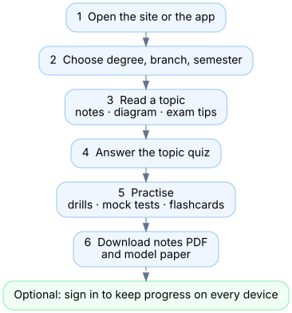

## From my problem to other people's tool

The second motivation arrived as soon as the first version worked. Classmates asked for the link. Then juniors asked whether the fifth semester could be added, and seniors asked about the seventh. Then friends in Electronics asked whether there was an ECE version. Within a few months the question had changed from "does this help me revise" to "can this help everyone at RGPV revise".

Those two faces of the project explain most of its design. As a tool for myself, it favours depth over breadth: every topic page is long, every subject has an exam blueprint, and I would rather have five subjects done properly than fifty done badly. As a tool for other people, it favours structure: the content has to be organised by the university's own scheme, the navigation has to stop people getting lost, and the whole thing has to be maintainable by someone other than me. The November rebuild is where the second face finally won enough to change the architecture.

# 2. RGPV in one chapter

The rest of this book assumes a working picture of how RGPV organises its programmes. This chapter gives that picture briefly.

## Degrees, branches and semesters

RGPV awards the Bachelor of Technology (B.Tech) over eight semesters and the Master of Technology (M.Tech) over four. A B.Tech student belongs to one branch: Computer Science and Engineering (CSE), Information Technology (offered at many colleges as CSIT), Electronics and Communication (ECE, code EC), Electrical and Electronics (EX), Mechanical (ME), Civil (CE) and Automobile (AU) are the branches Academy LMS now covers. An M.Tech student belongs to a specialisation such as Computer Science, VLSI Design, Thermal Engineering, Structural Engineering or Power Systems.

The first year is common to all branches. Every B.Tech student studies the same ten papers in semesters one and two, coded BT-101 to BT-105 and BT-201 to BT-205: engineering chemistry, mathematics, communication skills, basic electrical and electronics, engineering graphics, physics, basic computer engineering, basic mechanical engineering, basic civil engineering and manufacturing practices. From the third semester the branches diverge.

## Paper codes

Every paper has a code made of the branch prefix, the semester digit and a serial number: CS-601 is the first CSE paper of semester six, ME-304 is the fourth Mechanical paper of semester three. Electives carry a letter in brackets: CS-603(C) or CE-702(B). Two codes matter for the design of Academy LMS. First, the same subject often appears in several branches under different codes. Data Structures is a CSE paper and an IT paper; Strength of Materials is taught to Mechanical, Automobile and Civil students. Second, the common papers BT-301 (Mathematics-III) and ES-301 (Energy and Environmental Engineering) appear in every branch, but in semester three for some branches and semester four for others.

Both facts pushed the design towards separating *subjects* from *where they appear*. A subject is one body of content; a placement is a (branch, semester, code) triple that says where a student meets it. Chapter 18 explains how that idea became the programme plan.

## The paper and the marks

An RGPV end-semester theory paper is worth seventy marks and usually contains eight questions, of which the student answers five, each worth fourteen marks and usually split into two seven-mark parts. Within that, the questions follow a pattern every student learns to recognise: a short definition or distinction worth two or three marks, an explanation with an example worth four, and a long answer, often with a diagram, a derivation or a numerical, worth seven. Internal tests and the shorter parts of older papers use the smaller pieces; the long answers carry the paper. Internal assessment adds class tests, assignments and attendance.

That structure is why every Academy LMS topic page ends with an *RGPV exam blueprint*: a short section that says what a two-mark answer should contain, what a four-mark answer adds, and what turns a seven-mark answer from adequate to full marks. It is also why the model papers the generator produces have eight questions with two seven-mark parts each, in two sets, and why the question bank is organised by unit.

## What a student actually needs

Watching classmates revise taught me that students need four things from a study tool, roughly in this order. They need to know *what* is in their semester, without wading through other semesters. They need an explanation they can read in ten minutes and a diagram they can reproduce in an exam. They need a way to check themselves. And they need to know where they stand: what is done, what is not, and what to do next. Everything in Academy LMS maps to one of those needs, and features that did not map to any of them, such as a leaderboard I once sketched, never got built.

# 3. The first day

## Five subjects, three files

The first version went up on 13 May 2026 as three files: `index.html`, `app.js` and `data.js`. The page was titled "Academy LMS — Linear Aesthetic", after the dark, high-contrast style of the Linear project-management tool that inspired its look. It loaded Tailwind from its CDN, configured it inline with a custom colour palette, and loaded Mermaid from jsDelivr to draw diagrams.

`data.js` held a single array, `coursesData`, with the five sixth-semester subjects. Each course had an id (`cs601`), a code, a title, a short light-hearted description, and a list of units; each unit had a list of topics with an id and a title. Twenty-one topics in total. The content for each topic lived in a second object keyed by unit and topic, so the navigation could load without the content.

`app.js` was about 270 lines. It rendered the subject tabs, the unit sidebar and the topic view, ran Mermaid over any diagram in the content, and kept a set of completed topics in `localStorage`. There was no router, no framework and no build. Opening `index.html` from a folder worked as well as opening it from a server.

## The lab computer incident

The same afternoon produced the project's most embarrassing commit history. I was working on a college lab machine, and the folder I synchronised to GitHub turned out to be the whole Windows user profile rather than the project folder. Over about sixteen minutes, between 12:38 and 12:54, the tool I was using created 474 commits named "Sync E:/UserProfile/0902CS231028/…", one per file, and pushed them: browser extensions, editor settings and even `ntuser.dat`, the file in which Windows stores the settings of a user account.

The cleanup came in two steps. A few "Cleanup absolute paths" commits removed the obvious mistakes, and the next substantial commit, "Upgrade study experience and add maintenance workflows", deleted the rest: it shows 122,866 lines removed across 482 files, nearly all of them from the stray profile. The files are gone from the tree, but the commits remain in the history, and anyone who scrolls far enough down the log will find them.

Two lessons came out of it, and both shaped the later repository. The first is mechanical: a `.gitignore` and a quick look at `git status` before the first push are cheaper than any cleanup. The second is about trust: a repository that other people clone has to be boring at its root. The November rebuild spent real effort on that boredom: a clear top-level layout, generated files kept in known places with markers around them, and a continuous-integration check that fails if anyone commits generated output that does not match its source.

## The same evening

The rest of 13 May was a burst of features, visible in the history as a run of large commits within hours of each other. "Upgrade study experience" split the single page into a shell with shared code (`js/shared.js`), a study desk (`js/app.js`), a tests page (`js/tests.js`), a lectures page and a resources page, and moved the styling into `assets/css/app.css`. "Expand core subjects and restyle study portal" deepened the content of the five subjects and replaced the dark Linear look with the light blue theme the site still uses. "Add mock test history and deepen PM/graphics content" added timed mock tests that remember past attempts. "Add resource workflow and student profile tools" added a profile page and the first version of the resource upload pipeline. And "Add Neon-backed student community features" connected the site to a database for the first time.

Looking back, that day did two things at once. It produced a genuinely useful study tool for one semester, and it committed the project to an architecture, plain files, a shared script, page-per-feature, and an optional server, that every later phase had to live with. Part II looks at that architecture and the reasons for it.

# Part II — The study desk {.part}

How the May build was put together, and why it was put together that way.

# 4. Architectural choices

## No framework, on purpose

The obvious choice in 2026 for a site like this is a JavaScript framework: React or Vue for the interface, a bundler to build it, and a router to move between pages. I chose none of them, and the reasons still hold.

The first reason was the audience. Most RGPV students open the site on a mid-range Android phone over a mobile connection, often inside a college building with poor signal. A framework adds a runtime that must download and start before anything appears; plain HTML appears as soon as it arrives. The second reason was editing. In May the content changed every hour. With plain files, a change to a topic is an edit to one JavaScript object and a page refresh, with no compiler, no watcher and nothing to install. The third reason was longevity. A static site with no build step can be served by anything, from Vercel to a USB stick, and will still open in ten years. A framework project from 2026 may not even install in 2030.

The cost of that choice is real and I have paid it. Without components, the same markup patterns are repeated as template strings across several files. Without a state library, every page has to subscribe to the same custom events by hand. Without a router, each feature is its own HTML page that loads the shared script. I would make the same choice again for this project, but I would no longer pretend it is free.

## One shared script, many pages

The site is a set of pages, `index.html` for the landing page and the study desk, and `html/tests.html`, `html/lectures.html`, `html/resources.html`, `html/profile.html` and a few informational pages, each of which loads `js/shared.js` first and then its own script.

`shared.js` is an immediately-invoked function that builds a single object, `window.ACADEMY`, and everything that more than one page needs hangs off it: the student's state and the functions that save it, cloud sync, sign-in, the programme API added in November, statistics, export, escaping helpers and a small prefetcher that warms the next page when a link is hovered. Page scripts read and write state only through that object. When the state changes, `shared.js` dispatches an `academy:state-changed` event on `window`, and any page that cares re-renders its parts.

This pattern, one global namespace and DOM events, is old-fashioned, but it has two properties I value. Any page can be understood by reading two files. And nothing breaks when a page is opened directly from disk, which is exactly how the Windows app's offline mode serves the site years later.

## Data as JavaScript

The curriculum is stored as JavaScript rather than JSON. `js/data.js` defines `coursesData`, the list of subjects with their units and topic titles, and the detailed content lives in one file per subject, `js/data_<id>.js`, which fills a global object `window.topicDetails[unitId][topicId]` with the topic's HTML and its quiz questions.

Using JavaScript files instead of JSON fetched over HTTP has a practical advantage: a `<script>` tag works from `file://` URLs, while `fetch` of a local JSON file does not. The study desk loads only `data.js` up front, a few hundred kilobytes describing every subject's outline, and loads a subject's detail file the first time the student opens that subject, by inserting a `<script>` element and waiting for its `load` event. In November, with 163 subjects and about thirty megabytes of content, that lazy loading is the only reason the desk still opens in a second.

## Pages, not a single-page app

Each feature is a separate page because each feature has a different shape. The study desk is a three-column reader. The tests page is a quiz engine with a timer. The lectures page is a player with a playlist drawer and a chat panel. Forcing them into one page would have meant one large script that knows about everything. Separate pages let each script stay focused, and the shared object keeps them consistent. The price is a full page load when moving between features, which the hover prefetcher mostly hides.

# 5. Anatomy of a topic page

## The template

Every topic in Academy LMS follows the same outline, which grew out of how I revised for the sixth semester:

1. A title and a line giving the subject code and unit.
2. A short overview: what this topic is, in two or three sentences.
3. **Core concepts and key points**: a grid of cards, each defining one term the topic depends on.
4. A **concept map**: a Mermaid diagram linking the topic to the ideas around it, with links to the previous and next topics.
5. A **quick revision table**: term and meaning, in a form that can be copied into a notebook the night before.
6. An **in-depth explanation**: the long-answer material.
7. An **RGPV exam blueprint**: what a two-, four- and seven-mark answer on this topic should contain.
8. **Video lectures and study material**: lecture links, the subject's notes PDF and model paper, the official RGPV portal and standard textbooks.
9. A short quiz.

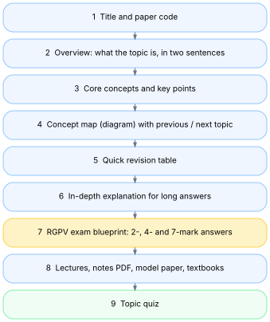

The hand-written pages from May and September follow this outline loosely; the generated pages from November follow it exactly, because the generator writes it. Keeping the outline fixed has a cost, since some topics deserve a worked derivation rather than a table, but it has a much larger benefit: a student who has read one page knows where everything is on every other page.

## Diagrams with Mermaid

Diagrams are written as text inside the content, in a `<div class="mermaid">`, and rendered in the browser by Mermaid. That decision made the content possible at all. Drawing hundreds of diagrams by hand in a drawing tool and exporting images would have taken weeks and made every correction painful; writing `graph LR; A --> B` takes seconds and diffs cleanly in Git.

Mermaid is large, so it is not loaded with the page. The study desk checks whether the topic it has just rendered contains a diagram, and only then inserts the Mermaid script, initialises it once with a neutral theme, and renders the diagrams in place. Topics without diagrams never pay for it.

## Highlights and notes

Two features turned the topic page from something you read into something you study from. The first is highlighting: select text in a topic and a small toolbar appears with *Highlight*, *Remove current*, *Remove last* and *Cancel*. Highlights are stored per topic as the selected text, and re-applied by searching for it whenever the topic is rendered. The second is notes: each topic has a notes box that saves as you type. Both live in the student's state, so they survive a refresh, and they travel with the profile export.

That toolbar later caused one of November's bugs. A CSS rule gave the toolbar `display: flex`, which silently overrode Tailwind's `hidden` class, so on the landing page the four buttons were permanently visible over the hero text. The fix was one line, `.selection-menu.hidden { display: none; }`, but finding it meant noticing that "the toolbar is always there" was a styling bug, not a logic bug.

# 6. The progress engine

## One object, saved on every change

Everything a student does is recorded in a single state object, saved to `localStorage` under the key `academy_lms_state_v4`. Its fields read like a list of the features: `completedTopics`, `quizAttempts`, `notes`, `highlights`, `bookmarks`, `examDrafts`, `practiceSessions`, `recentTopics`, `lastVisited`, the student's name and avatar, a randomly generated `deviceId`, and a `remoteSync` block describing the last cloud sync. The `v4` in the key records that the format has changed three times before. Each change used a new key instead of converting old data, which is a simple approach, but it guarantees that a browser holding old data never fails on the new format.

Loading the state is defensive. It reads the stored JSON, merges it over a default object so that missing fields are filled in, generates a device ID if there is none, and, if the stored data cannot be parsed at all, starts fresh rather than leaving the page blank. Saving stamps `updatedAt`, writes the JSON back and dispatches the change event.

## Statistics that answer "where am I?"

The profile page and the study desk's overview cards are driven by one function, `calculateStats`, which walks the curriculum and the state together and returns, for each subject, how many topics exist and how many are done, the overall completion rate, quiz accuracy, the number of notes, highlights and bookmarks, and the last visited topic. In November it gained one important change: the totals are now scoped to the student's own semester. Before that, a sixth-semester student who had finished every sixth-semester topic still saw "34% complete", because the denominator included every other semester on the site.

## Export and sync

A student can download their whole state as a JSON snapshot from the profile page. The snapshot includes a `topicDirectory` that maps topic IDs to readable titles, so the file means something outside the site. To keep it small, the directory includes only topics the student has actually touched; with 3,300 topics on the site, including all of them would have made every snapshot hundreds of kilobytes.

When the student is signed in, the same state is synchronised to the cloud. The sync is deliberately lazy: a change schedules a sync a couple of seconds later if the page is in the foreground and about nine seconds later if it is not, and no two syncs run within twelve seconds of each other. A burst of quiz answers therefore produces one upload rather than twenty. Chapter 8 describes what happens on the server.

# 7. Practice

## Drills, mock tests and history

The tests page grew from a simple idea: every topic already has quiz questions, so the whole subject has a question bank. `buildPracticeBank` collects every question from every loaded subject in the student's semester, and the page offers two modes on top of it. *Topic drills* pick a set of questions for a subject or a unit and give instant feedback on each answer. *Timed mock exams* pick a larger set, start a countdown, and submit automatically when time runs out. Every session is saved with its score, mode, duration and timestamp, and the history panel lists past sessions so that a student can see whether the last week of revision actually moved their accuracy.

## Flashcards

Flashcards came next. They reuse the same question bank: the deck is twenty-five random questions from the student's semester (or one subject), the front of each card shows the question, the back shows the answer, and the student marks each card *mastered* or *needs review*. The page keeps a running count of both. It is not spaced repetition, because cards marked for review do not come back on a schedule, and that is an obvious improvement waiting to be made. Even in this simple form, it was the part of the tests page that classmates told me they used most in the last two days before a paper.

## Numerical trainers

The most satisfying part of the practice module to build was the set of numerical trainers, one for each kind of calculation that RGPV papers love: IPv4 subnetting for Computer Networks, RSA and Diffie–Hellman key exchange for cryptography, the critical path method for Project Management, parsing tables for Compiler Design, DFA minimisation, functional-dependency closure for databases, cellular frequency reuse for wireless communication, HDFS block placement for big data, and a few architecture calculations. Each trainer generates a fresh problem with random numbers, checks the student's answer, and can reveal a worked solution.

These trainers are hand-written and exist only for CSE subjects. They are one of the clearest places where the November rebuild did not reach: the generated subjects have drills, mock tests and flashcards, but no numerical trainers yet. A Thermodynamics cycle trainer or a beam shear-force trainer would be just as useful to a Mechanical or Civil student, and the roadmap lists them.

# Part III — Going online {.part}

What changed when the study desk gained a server, a database and other people.

# 8. Neon and serverless functions

## Why a database at all

For the first few hours the site needed no server. Everything a student did was saved in their own browser, and that was the point. Three requests changed that within a day. Classmates wanted their progress on both the phone and the lab computer. They wanted to see each other: who else was studying a topic, and what they thought of it. And I wanted a way to collect notes and assignments from other students without asking them to email me files.

All three needed a shared place to store data, and the commit "Add Neon-backed student community features" on 13 May added one. The choice of Neon came from the hosting. The site was already deployed on Vercel as a static site, and Vercel runs any JavaScript file in a top-level `api/` folder as a serverless function. A serverless function starts on demand, handles one request and stops, so it cannot hold a long-lived database connection. Neon is a hosted PostgreSQL service whose serverless driver, `@neondatabase/serverless`, sends each query over HTTP. A function can import it, run a query and return without managing a connection pool, which is exactly the shape Vercel functions need.

## The functions

The `api/` folder holds one file per area: `profile.js` for the student record and state sync, `auth-google.js`, `auth-session.js` and `auth-logout.js` for sign-in, `topic-comments.js`, `lecture-chat.js`, `messages.js` and `social.js` for the community features, `blob-upload.js` for files, `report-user.js` and `admin.js` for moderation, and `app-config.js`, which tells the browser which features the server has switched on. Shared helpers live in `api/_lib/`: `db.js` for queries and sessions, `http.js` for reading bodies, parsing cookies and sending JSON, `rate-limit.js`, `admin-auth.js`, and `mock-db.js`.

Queries are written as tagged template literals: `` sql`SELECT … WHERE device_id = ${deviceId}` ``. The driver turns each interpolated value into a query parameter, so values are never pasted into SQL text. That one convention removes the most common class of database security bug without any effort at the call site. The one problem it caused was with data types: on 29 May the Google sign-in query (which creates or updates a student record) started failing because Postgres could not infer the type of a parameter used in two places, and the fix was an explicit cast.

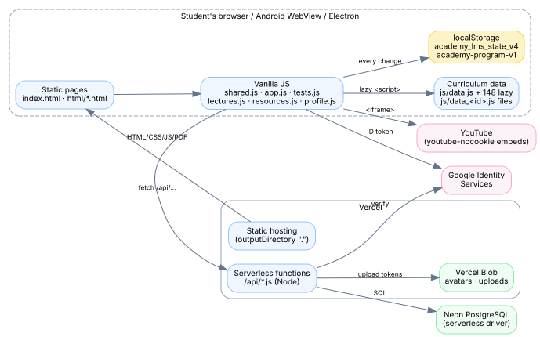

## Twenty tables

Over the summer the schema grew to about twenty tables. The heart is `students`: one row per student, keyed by a `device_id` for guests and by `google_sub`, Google's stable account ID, for signed-in students. Study data hangs off it: `student_topic_progress`, `quiz_attempts`, `practice_sessions`, `exam_drafts` and `student_state_snapshots`. The community features add `topic_comments`, `lecture_messages`, `lecture_presence`, `lecture_watch_events`, `direct_messages` and `student_connections`. Files are recorded in `student_uploads`, sessions in `student_sessions`, and moderation in `student_reports` and `banned_devices`. A few summary views, such as `student_profile_summary` and `topic_stats`, keep the profile and admin pages from running large aggregations on every load.

## Working without a database

The September commit "enable local & Neon db study workspace without requiring Google OAuth" fixed a problem I had created in May. Without my noticing, the site had come to assume that a database was always present. Run it locally without the right environment variables and the profile page failed, sign-in failed, and parts of the study desk showed error states. Anyone who cloned the repository to contribute hit this in the first five minutes.

The fix was `api/_lib/mock-db.js`, about 800 lines that imitate the subset of SQL the functions use against in-memory JavaScript arrays. `getSql()` looks for `DATABASE_URL` (or `POSTGRES_URL`); if it finds one, it returns the Neon driver; if it does not, or if the driver fails to load, it logs a warning and returns the mock. Everything works locally, nothing persists across restarts, and nobody needs a Neon account to try the site. The same fallback is what lets the Docker image and the Windows app start with no configuration at all.

The lesson is one I now apply everywhere: decide what the system does *without* each external service before you depend on it. The study desk was designed to work without a server; the server should have been designed to work without its database from the start.

# 9. Sign-in and sessions

## Guests first

Every visitor is a guest until they choose otherwise. On the first visit, `shared.js` generates a random device ID (a UUID from `crypto.randomUUID()`) and stores it in the state. When the guest first syncs, `/api/profile` creates a `students` row for that device ID. A guest can study, take tests, comment and chat with no account. On 13 September the commit "remove mandatory authentication for platform access" made that the rule after a summer in which parts of the site required sign-in: the gate was keeping out exactly the students who only wanted to read one topic before an exam.

## Google sign-in

Signing in uses Google Identity Services. The page loads Google's client script, renders the standard "Sign in with Google" button, and receives an *ID token*: a signed JSON Web Token that says which Google account the user is. The browser posts that token to `/api/auth-google`, and the server verifies it with Google's official `google-auth-library`, checking the signature and that the token was issued for this site's client ID. Only the verified contents of the token are trusted: the account's stable `sub`, the email, the name and the picture URL. The site never sees a password and asks for no extra permissions.

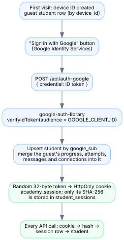

## Merging the guest into the account

The interesting part of sign-in is not authentication but merging. A student usually studies as a guest for a while before signing in, and they expect that history to follow them. When the verified account already exists, `auth-google.js` moves everything that belonged to the guest row into the account row: topic progress (dropping duplicates the account already has), exam drafts, quiz attempts, practice sessions, lecture watch events, presence, chat messages, comments and connections (dropping self-connections and duplicates). Each step is wrapped in its own `try`, so a missing table in an older database cannot abort the whole merge.

## Sessions that leak nothing

After verification the server creates a session. It generates 32 random bytes, sends them to the browser as an `HttpOnly`, `Secure`, `SameSite=Lax` cookie called `academy_session`, and stores only the SHA-256 hash of the token in `student_sessions`. Every API call reads the cookie, hashes it and looks up the session. If the database ever leaked, the stored hashes could not be replayed as cookies. Logging out deletes the session row and clears the cookie.

# 10. Studying together

## Comments on topics

The first community feature was the simplest: a comment thread under every topic. It answered a real need, because the most useful thing a classmate can tell you about a topic is often "this came in the 2024 paper" or "the textbook's derivation skips a step". Comments are stored with the topic ID and the student, and `topic-comments.js` serves them newest first with a comment count per topic.

## Lecture rooms

The lectures page added a light form of presence. While a student watches a lecture, the page sends a heartbeat every few seconds and polls `/api/lecture-chat` for messages, in two scopes: a *local* room for the lecture itself and a *global* room shared by everyone on the lectures page. The polling pauses while the browser tab is hidden and never runs two requests at once. It is polling, not WebSockets, because serverless functions cannot hold open connections, and for a few dozen students a poll every few seconds is perfectly adequate. The room is keyed by the lecture, so everyone watching the same Compiler Design playlist at eleven at night can see each other and talk.

## Connections and messages

September's "implement social connection management" added a small social graph. A student can send a connection request; the other student can accept, reject or ignore it; either can later disconnect. `social.js` implements those actions as a small state machine over the `student_connections` table, and `messages.js` allows direct messages between connected students. Profiles gained a bio, a headline, and links to GitHub, LinkedIn and a personal website, because classmates wanted to find each other's projects as much as each other's notes.

I hesitated over this feature. A study tool does not obviously need a social network, and every social feature brings moderation work. In the end the deciding argument was practical: students already used WhatsApp for exactly these conversations, and keeping a topic's discussion next to the topic made it findable a semester later. Chapter 12 describes what it cost.

# 11. Uploads and the resource library

## Two kinds of files

The resource library holds two kinds of files. *Curated* resources are committed to the repository under `assets/resources/<subject>/<type>/`: notes, assignments, mock papers and slides. *Student uploads* are PDFs and slide decks shared through the site, stored in Vercel Blob.

## The upload inbox workflow

Curated resources arrive through a folder called `incoming_resources/`. I, or anyone with write access, drop files there with descriptive names, such as `cs602-network-notes-unit3.pdf`, and push. The workflow `organize-resources.yml` runs `scripts/organize_resources.js`, which classifies each file by subject and type from tokens in its name (`cs602`, `network`; `notes`, `assignment`, `mock`, `slides`), moves it into the right folder, generates a readable title from the filename, and rewrites the resource manifest `js/resource-library.js` that the resources page reads. The bot commits the result. The history shows several "Organize uploaded study resources" commits from `github-actions[bot]`.

In November this script nearly destroyed the generated resource library. It rewrote `resource-library.js` from scratch, which was fine when the manifest held only uploaded files, but the generator now writes 444 entries into the same file. The fix was to give the generated entries their own marked block, `<<MULTIBRANCH-RESOURCES:START>>` to `:END>>`, teach the organiser to preserve that block and skip generated files, and check that running it twice changes nothing.

## Direct uploads to Blob

Student uploads go straight from the browser to Vercel Blob, without passing through a function. The page asks `/api/blob-upload` for permission; the function checks that the student is signed in and not banned, and returns a short-lived upload token that allows only certain content types: JPEG, PNG and WebP for avatars, PDF and PowerPoint for study files. The browser uploads to Blob with that token, and when the upload completes, Blob calls the function back to record the file in `student_uploads` with its size and title.

Two of the 29 May fixes came from this path. The browser and server packages of `@vercel/blob` had drifted to different versions, and the browser upload failed with an unhelpful error until they were aligned. And the profile page crashed when it tried to format a file size that was missing, which needed a guard. A third fix in the same batch added an automatic check for uploaded solutions. When a PDF arrives, the function downloads it, extracts its text with `pdf-parse`, and looks for a small set of keywords for the subject: *scope*, *risk*, *milestone* and *budget* for Project Management, and so on, with a generic set (*definition*, *example*, *advantages*) for other subjects. If at least 45% of the keywords appear, the upload is tagged *likely correct*; otherwise it is tagged *needs review* for a moderator. The check is simple, but it reliably catches the most common problem: a student uploading the wrong file.

# 12. Moderation

## Reports and bans

Every community feature needed a way to deal with abuse. Any student can report another; the report lands in `student_reports` with a reason. The admin dashboard (`admin/index.html`, served at `/admin`) lists open reports, recent uploads, chat messages and students, and lets an administrator ban or unban a student, ban a device (for abusive guests who never sign in), resolve or dismiss a report, delete an upload and delete chat messages. A banned device is recorded in `banned_devices` and checked by every function that writes data.

## Who counts as an administrator

Access to the dashboard has two paths. The normal one is signing in with Google using an account on the admin list: a small built-in set plus anything in the `ADMIN_EMAILS` environment variable. The fallback, for setting up a new deployment before anyone can sign in, is a shared secret in an `x-admin-secret` header.

That fallback was the worst security bug in the project, and I found it only while writing this book. The check accepted the configured `ADMIN_SECRET`, but it also accepted the literal strings `admin123` and `admin` *even when a real secret was configured*, and it accepted the secret from a URL query parameter. Since the admin email list is in a public repository, anyone who read the code could have banned students or deleted uploads. The fix, in version 2.2.1, accepts the secret only from the header, compares it in constant time, requires a configured secret of at least twelve characters, and allows the development default `admin123` only when the server is running against the in-memory mock store, where there is nothing to protect.

The lesson is uncomfortable but simple. A convenience added "just for testing" becomes production behaviour the moment it is deployed, and the person least likely to notice is the one who added it.

# 13. Lectures

## Embedding YouTube

Almost every RGPV student learns part of every subject from YouTube. The lectures page exists to make that less chaotic: one place that lists the useful playlists for each subject, plays them without leaving the site, and keeps the chat room for that lecture alongside.

The player is a plain YouTube embed: an `<iframe>` pointed at an `/embed/` URL, with `loading="lazy"`, a strict referrer policy and the usual `allow` list for autoplay, fullscreen and picture-in-picture. The page uses YouTube's standard player directly, without any additional library, because it only needs to show a video, not control it. A small function, `normalizeLectureUrl`, turns whatever link I pasted into an embed URL. A `watch?v=` link becomes `/embed/<id>`, a `youtu.be` short link becomes the same, a link with a `list=` parameter keeps the playlist, and a bare playlist becomes `/embed/videoseries?list=<id>`. Every embed adds `rel=0` so the end screen suggests videos from the same channel rather than anything YouTube likes.

By default the embed is served from `www.youtube-nocookie.com`, YouTube's privacy-enhanced mode, which does not set tracking cookies until the student actually plays the video. A toggle switches to the normal `www.youtube.com` host, because a few videos refuse to play in privacy mode and some networks block the nocookie domain. When a video still refuses to load, a *reload player* link resets the iframe, which fixes the most common failure: an embed that stalled on a slow connection.

## The playlist library

The curated playlists live in `js/lecture-library.js`, about 1,400 lines of objects describing each playlist or video: subject, semester, title, channel, URL and a short note on what it covers. On 29 May the lecture tab gained a searchable, multi-subject picker, and on 13 September the old sidebar was replaced with a *playlist drawer* that slides over the player on phones.

## Generated lecture shelves

The November rebuild added 148 subjects, and I could not hand-pick playlists for all of them. Instead, each generated subject gets a *lecture shelf*: for every unit, a set of YouTube search links built from the unit and topic names ("Strength of Materials unit 3 bending stress RGPV"), labelled as searches. The lectures page builds these shelves from the curriculum, and topic pages carry the same links.

This is the part of version two I am least satisfied with. A search link is honest, because it says what it is and always returns something, but it is not curation, and the quality of the results varies. Hand-picking playlists for the most-studied subjects of each branch is near the top of the roadmap, and the shelf format was designed so a curated playlist can replace a search link without changing anything else.

# 14. The fix-up week

## Five pull requests

On 29 May five pull requests landed from my second GitHub account, each a focused fix found by actually using the site for a week:

1. **Postgres parameter typing in the Google sign-in query.** The query used a parameter whose type Postgres could not infer, so sign-in failed for new accounts.
2. **Vercel Blob SDK versions.** The browser and server halves of the upload library were on different versions, and browser uploads failed.
3. **Study file uploads, byte formatting and PDF keyword checks.** PowerPoint uploads were rejected by an over-strict content-type check, the profile page crashed on files without a recorded size, and solutions gained the automatic keyword check.
4. **Resources auth bootstrap, and Tailwind built instead of loaded from a CDN.** The resources page called the session API before the shared script had set up sign-in, and the site was still styled by the Tailwind CDN script.
5. **A searchable multi-subject lecture picker**, replacing a fixed list that had grown too long.

Working through pull requests, even alone, changed how I worked. Each fix had to be described, kept small and reviewed as a diff before it was merged, and each one is still readable in the history as a unit. Compare that with 13 May, when a single commit could add a feature, restyle the site and delete a hundred thousand lines.

## Leaving the Tailwind CDN

The first version loaded Tailwind from `cdn.tailwindcss.com`, which compiles CSS in the browser on every page load from the class names it finds. It is the fastest way to start and the wrong way to ship: Tailwind's own documentation says not to use it in production, it adds a large script to every page, and the page briefly appears unstyled before the script runs.

The fix moved Tailwind to a build step. `tailwind.config.cjs` lists the files to scan (the HTML pages, every script in `js/` and the admin pages), `assets/css/tailwind.input.css` holds the three Tailwind directives, and `npm run build:tailwind` produces a minified `assets/css/tailwind.css` containing only the classes actually used. The build output is committed, so the deployed site still has no build step; the step runs on my machine when the markup changes. The site's own design, the colour variables, panels, cards, pills and the light background gradient, lives separately in `assets/css/app.css`, which loads after Tailwind and overrides it where the two disagree.

The one trap with this setup arrived in November. Tailwind only generates classes it can see in the scanned files, and the generated subject files are in `js/`, so classes used only in generated topic pages are picked up. But a class built from pieces at runtime, for example a colour name chosen from a variable, is invisible to the scanner and silently missing from the CSS. Generated markup therefore uses whole class names, never assembled ones.

# 15. September

## Semesters five and seven

In September the site grew from one semester to three. The fifth semester added Theory of Computation, Database Management Systems, Data Analytics and its Cyber Security elective, and Internet and Web Technology. The seventh semester added Software Architectures, the two CS-702 electives Big Data and Wireless and Mobile Computing, and the two CS-703 electives Cryptography and Information Security and Disaster Management. That made fifteen hand-written subjects, about 350 topics, and the first semester filter on the study desk.

The filter was a row of pills, *Sem 5*, *Sem 6*, *Sem 7*, and it worked because there were only three semesters and one branch. It is also the direct ancestor of the navigation problem in Chapter 18: a sixth-semester student who tapped the wrong pill saw a different semester's subjects with nothing to say that they had left their own.

## Speed

On 13 September "optimize app performance and loading" attacked load time. The local Express server gained gzip compression. The shared script began caching the app configuration and the auth session in `sessionStorage`, so moving between pages no longer waited on two API calls before rendering; the cached values are shown immediately and revalidated in the background. The study desk began preloading the other subjects of the current view after the first one rendered. And the hover prefetcher appeared: when the pointer enters a link to another page of the site, a `<link rel="prefetch">` asks the browser to fetch that page in the background, so the click usually lands on a page that has already arrived.

## The first Android build and Vercel

On 4 September the project gained two things that later grew into the release pipeline. The first was an Android app: a minimal native project whose only activity is a WebView pointed at the live site, built by a GitHub Actions workflow. The second was `vercel.json`, a one-line file setting `outputDirectory` to `.` so that Vercel serves the repository root as the site and the `api/` folder as functions, with no framework detection and no build command.

The first Android workflow had a bug that took two months to notice: it published a GitHub Release tagged `v1.0.0` on every push to `main`, overwriting the same release again and again. Version two split it into a continuous-integration build on every change to the Android code and a separate release workflow that runs only for version tags.

# Part IV — Version two {.part}

Every branch, every semester, and the machinery that made that possible.

# 16. Every branch, every semester

## A larger goal

By November the site had fifteen hand-written CSE subjects across three semesters, and the requests had not stopped. Juniors wanted semesters three and four. Friends in IT, Electronics, Mechanical and Automobile wanted their branches. First-year students, who share ten papers across every branch, wanted those. I wrote the goal down in one sentence: every RGPV B.Tech branch, every semester from one to eight, and the M.Tech theory semesters, with every subject at the level of the sixth-semester CSE pages, with papers, questions, study material, lecture links, original references and downloadable PDFs.

That sentence describes about 150 subjects and 3,000 topics. Writing each topic by hand, the way the May and September subjects were written, would have taken years. Something had to change in how content was produced, not just in how much of it there was.

## Working with an AI assistant

Version two was built with the help of an AI coding assistant, Claude, working in the repository under my direction over several long sessions; the version history records its commits under its own name. The division of work was clear. I defined the goals and constraints: which branches and semesters to cover, the sixth-semester CSE pages as the standard of quality, the existing design to be preserved, and the navigation rules. I tested every result on my own phone and asked for corrections where something was wrong. The assistant wrote most of the curriculum text, the generator, the navigation code, the automation and the first drafts of the documentation.

Two things made the collaboration work. First, the work was organised so that its output could be checked mechanically: the generator validates its input, a CI job fails if generated files are stale, and every change was exercised in a headless browser before it was committed. Second, limitations were stated openly rather than hidden. Where something could not be verified, such as the current RGPV scheme for Automobile semesters six to eight, which RGPV does not publish online, it said so, and the app now says so too.

## Separating content from code

The central decision of version two was to stop writing subjects as JavaScript. A subject is now written as plain text in a small curriculum language, and a generator turns that text into the JavaScript files the site already knew how to load. The hand-written CSE subjects from May and September were left exactly as they were; the generator writes new files alongside them.

The language is deliberately minimal. A file in `scripts/curriculum/` contains subjects, and each subject is a header line followed by units and topics:

```
@ ce601 | CE-601 | Structural Design & Drawing (RCC-I) | Limit state design of RCC beams, slabs, columns, footings and staircases as per IS 456.
# Design Philosophies
- Limit States | Structures must avoid failure states. | Limit State of Collapse = flexure, shear, torsion, compression | Limit State of Serviceability = deflection and cracking | Partial Safety Factor = 1.5 for loads, 1.5 for concrete, 1.15 for steel
```

`@` starts a subject: its ID, its paper code, its title and a description. `#` starts a unit. `-` starts a topic: its title, a one-sentence overview, and three or more term–definition pairs separated by `|`, each written as `Term = definition`. That is the whole language. It has two rules that matter: the pipe character can never appear inside text, and the term ends at the first ` = `. Breaking the first rule once, by writing a voltage magnitude as `|V|`, stopped the build with a clear error pointing at the line, which is exactly what a strict parser is for.

Fourteen files hold the whole of version two's content: the first year, the common papers, CSE semesters three, four and eight, IT, two files each for ECE and Mechanical, Automobile, Civil, Electrical, and two files of M.Tech programmes. Each subject has five units of four topics. Writing one subject this way takes an hour, not a week, and the text reads like revision notes, so anyone can check it against a textbook.

## The plan

The second input is `scripts/curriculum/plan.js`, which says where subjects appear. It defines the branches, with a name, a short name, an icon, a degree (B.Tech or M.Tech) and an optional note, and for each branch and semester the list of papers as (subject ID, paper code) pairs. The first year is defined once and spread into every B.Tech branch.

This is where the distinction from Chapter 2 between subjects and placements pays off. Data Structures is written once and placed in CSE and IT under different codes. Thermodynamics is written once and placed in Mechanical and Automobile. Strength of Materials appears in Mechanical semester three as ME-304 and in Civil semester three as CE-305. The common papers BT-301 and ES-301 appear in semester three for some branches and semester four for others. Because the progress engine stores progress by subject, a student who switches from Mechanical to Automobile keeps their Thermodynamics progress, and a student who looks at the same subject from two branches sees one set of notes, not two.

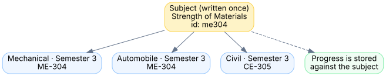

The third input, `references.js`, gives every subject three standard textbooks with authors: Rajput for Thermal Engineering, Bhavikatti for Structural Analysis, Kothari and Nagrath for power systems, Razavi for analog IC design. The generator refuses to run if a subject has no references, if a plan names a subject that does not exist, or if a subject exists but no plan uses it.

# 17. Generating a semester

## Topic pages

`scripts/build_multibranch_curriculum.js` reads the text files, the plan and the references, validates them, and writes three things. For each subject it writes `js/data_<id>.js`, filling `topicDetails` exactly as the hand-written files do, so the study desk needs no change to show generated subjects. It writes a block into `js/data.js`, between the markers `// <<MULTIBRANCH:START>>` and `// <<MULTIBRANCH:END>>`, that pushes the generated subjects onto `coursesData` and defines `window.BRANCHES` and `window.branchPlan`. And it prints a summary: for version 2.1, 148 subjects, 2,960 topics and 8,880 questions.

Each topic page is built from the topic's line of text into the full template of Chapter 5. The terms become the core-concept cards and the revision table. The overview opens the page. The concept map is a Mermaid diagram linking the topic to its terms, with the previous and next topics in the unit. The in-depth explanation weaves the terms into paragraphs. The exam blueprint names what a two-, four- and seven-mark answer on that topic should contain. And the study-material section links the subject's notes PDF and model paper, the RGPV portal, the three textbooks and four YouTube searches.

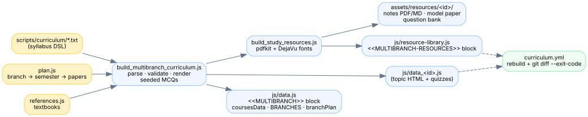

Markers matter more than they look. The generator owns everything between its markers and nothing outside them, so the hand-written part of `data.js` is never touched, and running the generator twice produces identical files. The continuous-integration workflow `curriculum.yml` relies on that. It reruns the generator and fails if `git diff` shows any change, which catches anyone who edited a generated file by hand or forgot to regenerate after changing the text.

## Questions that never change

Every topic gets three multiple-choice questions, built from its terms. A question either gives a term and asks for its description or gives a description and asks for the term; the three wrong options are drawn from other terms and definitions in the same subject, so they are plausible rather than absurd.

The interesting constraint is stability. If the questions were shuffled with `Math.random()`, every run of the generator would produce different files, the CI check would always fail, and a student's saved answer to "question 2" would point at a different question after every deploy. So the generator uses a seeded random number generator: a 32-bit FNV hash of the subject and topic ID becomes the seed of a small pseudo-random sequence. The same input always produces the same questions in the same order, and changing one topic changes only that topic's questions.

## Notes, model papers and question banks

The second script, `scripts/build_study_resources.js`, turns the same curriculum into files a student can download. For every subject it writes:

- **Unit-wise study notes** as a PDF and as Markdown: every unit, every topic, its overview and its terms, laid out for printing.
- **An RGPV-pattern model paper** as a PDF and as Markdown, in two sets. Each set has eight questions, one or two per unit, of which a student attempts five, for seventy marks. Every question has two seven-mark parts, (a) and (b), in the style of recent RGPV papers, and the Markdown version adds a short answer hint for each part. The topics are rotated between the two sets so they test different material. The paper says plainly that it is a practice paper, not an official RGPV paper.
- **A question bank** in Markdown, unit by unit, with answers.

The PDFs are drawn with `pdfkit` using the DejaVu fonts committed under `scripts/fonts/`, so symbols such as ε, Ω, Δ and ≤ render correctly. The fonts required the most care, because the standard PDF fonts cannot display most of the symbols used in engineering subjects. The PDF creation date is fixed, so regenerating produces byte-identical files and Git sees no change. The script registers every file in the resource library's marked block, which is how 444 new entries appear on the resources page without anyone typing them.

# 18. Navigation that keeps you in your semester

## The problem

With three semesters of one branch, a row of semester pills was enough. With seven branches, eight semesters and five M.Tech programmes, it became a real risk. The requirement was clear: a sixth-semester CSE student must never find themselves lost in the eighth semester of IT. With the old navigation, one wrong tap put a student in another semester's subjects with no sign that anything had changed, and the progress numbers silently counted subjects they would never study.

## My programme

The fix is a single idea: every student has a *programme*, a degree, a branch and a semester, and everything defaults to it. On the first visit the study desk opens a *programme picker*: a degree toggle (B.Tech or M.Tech), a grid of branches with icons, a row of semesters, and a live preview listing that semester's papers with their codes. *Set as my programme* saves the choice to `localStorage` under `academy-program-v1`. From then on the study desk, the tests page, the resource library, the lecture library, the progress modal and the profile all show that semester only.

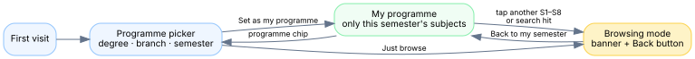

Other semesters are still reachable, but never by accident. The semester tabs on the study desk mark the student's own semester with a star. Tapping another semester enters *browsing mode*: a banner says "You are browsing ME, Semester 4. Your own semester is CSE · Semester 6", and a *Back to* button returns in one tap. A search result in another semester opens in the same mode. The programme chip at the top of the desk reopens the picker.

## Switching without losing anything

Students do change programmes, after a branch change, at the start of a semester or just to help a friend, and the obvious fear is losing progress. Switching never deletes anything. Progress, notes, highlights and quiz history are stored by subject and topic, not by programme, so switching only changes which subjects are shown. The picker says so in a line at the top, keeps the last four programmes as one-tap *Recent* buttons, and the profile page has a *Change programme* link.

## A little colour per branch

Each branch gets a slightly different accent colour, blue for CSE, cyan for IT, violet for ECE, orange for Mechanical, green for Automobile, while the layout, components and type stay exactly those of the original CSE pages. The study desk sets `data-branch` on the root element, and a CSS variable, `--branch-accent`, takes its value from that attribute. It is enough to tell at a glance which branch you are looking at, and not so much that the site feels like seven different products.

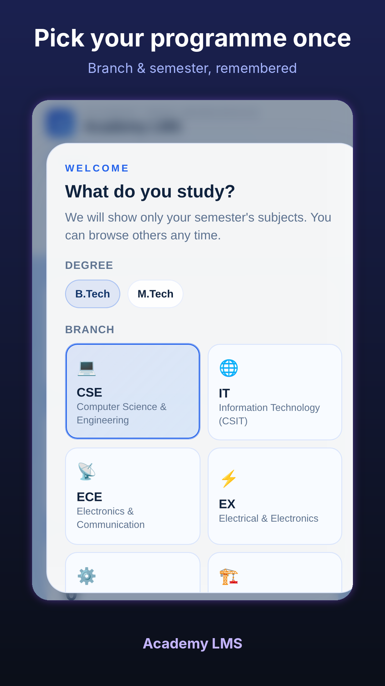{width=48%} 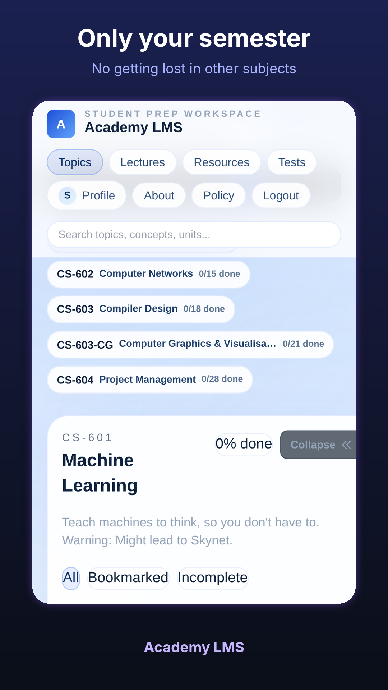{width=48%}

# 19. Civil, Electrical and M.Tech

## Two more branches

Civil and Electrical arrived in version 2.1, and they were the first test of whether the curriculum language had been worth it. Each needed one new text file of about twenty subjects, a plan entry per semester, and references; then the generator did the rest. Civil reused Strength of Materials, Fluid Mechanics, Operations Research and the IoT and Data Analytics electives from other branches. Electrical reused Signals and Systems, Network Analysis, Analog Circuits, Digital System Design, Control System and Microprocessors from Electronics.

## M.Tech

M.Tech was different in shape. An RGPV M.Tech has four semesters, but only the first two are mostly theory; the third and fourth are electives, seminars and the dissertation. Version 2.1 therefore covers semesters one and two for five programmes: Computer Science (advanced algorithms, architecture, networks, machine learning, distributed systems, security), VLSI Design (digital and analog IC design, fabrication, verification, low power, testing, SoC), Thermal Engineering, Structural Engineering and Power Systems. Every programme includes Research Methodology and IPR in semester two, written once and placed five times. The picker's degree toggle, a disabled "M.Tech, coming soon" pill in version 2.0, became functional, and the programme chip reads "M.Tech Power · Semester 2" instead of "B.Tech …".

## What I could not verify

Two parts of the curriculum are less certain than the rest, and the app says so rather than hiding it. RGPV does not publish the current Automobile scheme for semesters six to eight online, so those semesters use the most commonly offered papers, and the branch carries a note asking students to confirm codes with their department. M.Tech paper codes vary slightly between institutes, and the M.Tech programmes carry a similar note. Putting those notes in the picker, next to the choice they affect, was more useful than putting them in a README nobody reads.

# 20. Shipping

## Three products from one folder

By version two, Academy LMS ships as three things built from the same code: the website on Vercel, a Windows app and an Android app. Neither app contains a second copy of the logic. Both are thin shells around the website, and the differences between them are only in how they start, what they do when the internet is missing, and how they are installed.

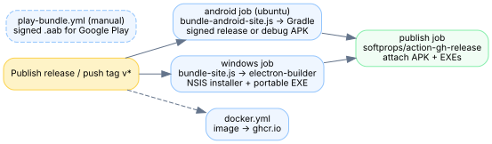

## The Windows app

The Windows app is built with Electron, which packages a copy of the Chromium browser and Node.js into a normal Windows program. The project lives in `desktop/`: a `package.json` with the `electron-builder` configuration, `main.js` for the main process, `bundle-site.js` to copy the site, and a splash page.

`main.js` does four things. It shows a splash window first: frameless, transparent, with the emblem glowing in with a slight bounce, the name and tagline rising beneath it, and a loading bar sweeping underneath. It creates the main window hidden and loads the live site. When the page finishes loading, after at least 2.2 seconds so the animation is never cut off, and at most eight, it shows the main window and closes the splash. And if the live site fails to load, it loads the bundled copy of the site from disk instead, so notes, quizzes and the generated PDFs still work offline. Links to YouTube, the RGPV portal and textbooks open in the student's normal browser rather than inside the app.

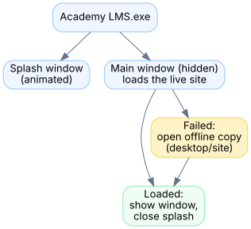

`electron-builder` produces two files: an NSIS installer, which installs the app with a Start menu entry and a desktop shortcut and lets the user choose the folder, and a portable EXE that runs without installing. Both use the Academy LMS emblem as their icon.

## The Android app

The Android app is a native project in `android/` with a single activity, `MainActivity`, written in Java. It hosts a WebView inside a swipe-to-refresh layout with a thin progress bar, enables JavaScript and DOM storage so the progress engine works, accepts cookies so sign-in works, opens external links in the system browser, and makes the back button navigate back inside the site before leaving the app.

The splash screen is built in code rather than as a video. While the site loads, a layer covers the WebView with a radial gradient, the emblem scales up from 55% with a small rotation and an overshoot, then pulses gently; the title and tagline slide up beneath it with a delay; and a gradient bar sweeps beneath them. The layer stays for at least 2.2 seconds and fades out once the page has loaded, or after seven seconds at most. On Android 12 and later the system's own splash screen shows the emblem first and hands over to the animated one.

I tried another route first. I wanted a generated video intro, wrote a detailed prompt for an AI video model, and abandoned it when the results looked worse than a few lines of animation code. The coded splash is smaller, sharper on every screen density, and can wait for the page to load, which a video cannot.

## Icons

The Academy LMS logo is a wide image: a glowing graduation cap over a circuit-board brain, beside the name. An app icon needs only the emblem, square, and on Android it needs an *adaptive* icon: a foreground layer that the system can mask into a circle, a squircle or a teardrop, over a background colour. The icons were cut from the logo, the dark background removed with a brightness key so the glow fades to transparency instead of leaving a box, and exported at every Android density from 48 to 432 pixels, plus a multi-size Windows `.ico`.

## Releases

`release.yml` runs when a version tag such as `v2.2.0` is created, usually by publishing a release on GitHub. It has three jobs. The Android job bundles the site into the app, builds the APK with Gradle, and signs it if the signing key is available as a repository secret. The Windows job copies the site into `desktop/site`, installs Electron and builds both EXEs on a Windows runner. The publish job runs only if both succeed, and attaches the APK, the installer and the portable EXE to the release. A separate `docker.yml` builds a container image for every push and tag and publishes it to the GitHub Container Registry, and `play-bundle.yml`, run by hand, builds the signed Android App Bundle that Google Play requires.

The Docker image exists for people who want to run the whole thing, functions included, on their own machine or a server. The `Dockerfile` installs the production dependencies, copies the site, and runs `server.js`, a small Express server that serves the static files with compression and passes `/api/*` requests to the same handler files Vercel uses. With no `DATABASE_URL`, the functions fall back to the in-memory store, so `docker compose up` gives a working site with no configuration at all.

# 21. Offline and the Play Store

## Offline on Android

The first Android app had an obvious gap: without internet it showed Android's "Webpage not available" error. Version 2.2 bundles the site into the APK at build time with `scripts/bundle-android-site.js`. That is every page, script, stylesheet and generated subject file, but not the PDFs, which would add tens of megabytes; the Markdown versions of the notes are included. The bundle is about 33 MB uncompressed and adds about 4 MB to the APK, because JavaScript compresses well.

The app serves the bundle through `WebViewAssetLoader` at `https://appassets.androidplatform.net/assets/site/`, a real HTTPS origin, rather than from a `file://` URL. That matters: `localStorage`, relative links and script loading all behave exactly as they do on the website. If the device is offline when the app starts, or the live site fails to load, the app opens the bundled copy. Pull-to-refresh tries the live site again once a connection returns.

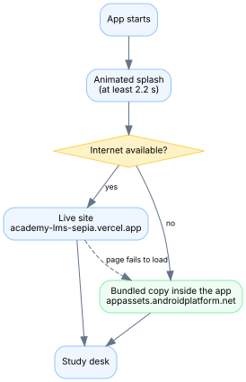

The limitation should be stated plainly. The bundled copy and the live site are different origins, so progress made offline lives in a separate store from progress made online. A student who mostly studies offline is unaffected; one who switches back and forth sees two sets of progress until they sign in, which syncs the online one. Making the two stores reconcile automatically is on the roadmap.

## Android 16

Google Play requires new apps to target the latest Android version, which in November 2026 is Android 16 (API level 36). Targeting it changes three behaviours, and each needed code. Apps are drawn edge to edge, under the status and navigation bars, so the root layout now applies the system-bar, display-cutout and keyboard insets as padding. The back gesture is *predictive*: the system no longer delivers the back key to the activity, so back navigation moved from `onKeyDown` to an `OnBackPressedCallback` that goes back in the WebView and only leaves the app at the first page. And the build tools moved to Android Gradle Plugin 8.11 and Gradle 8.14.

## Getting ready for Google Play

Publishing on Google Play costs a one-time $25 registration fee, and a new personal developer account must first run a closed test with at least twelve testers who stay opted in for fourteen consecutive days. I decided not to rush that. The better order is to grow real users on the website first; they become the testers, and later the first reviews.

The repository is ready for the moment that happens. `docs/play-store/` contains the store listing text within Google's length limits, a 512-pixel icon, a feature graphic, six captioned phone screenshots, answers for the data-safety and content-rating forms, a step-by-step launch guide covering the signing key, the GitHub secrets, the account and the closed test, and a share kit of ready-to-paste messages for WhatsApp, Instagram and LinkedIn.

# 22. One line, end to end

The generator is easiest to understand by following a single topic through it. This chapter takes one line from the Civil curriculum file and follows it until a student is reading it on a phone, answering its questions and downloading the paper it appears in.

## The line

In `scripts/curriculum/10-civil.txt`, under the subject CE-601 *Structural Design & Drawing (RCC-I)* and its first unit *Design Philosophies*, the second topic reads:

```
- Limit States | Structures must avoid failure states. | Limit State of Collapse = flexure, shear, torsion, compression | Limit State of Serviceability = deflection and cracking | Partial Safety Factor = 1.5 for loads, 1.5 for concrete, 1.15 for steel
```

The parser splits it on `|`. The first field is the title, *Limit States*. The second is the overview. Each remaining field is split at its first ` = ` into a term and a definition, so this topic has three terms. A field without ` = ` stops the build with the file name and line number. Because the topic is the second in the first unit, it gets the ID `ce601-u1t2`, inside the unit `ce601-u1`.

## The page

`buildTopicHtml` turns the parsed topic into HTML in a fixed order.

The heading is the title, followed by a line reading *CE-601 • Unit 1: Design Philosophies* and the overview sentence. Then comes a two-card grid. The first card, *Core Concepts*, lists the first two terms with their definitions; the second, *Key Points & Exam Focus*, lists the rest. A topic with five terms spreads them across both cards.

The concept map is a Mermaid diagram with the topic in the middle and an edge to each term, plus edges to the previous topic, *Working Stress vs Limit State*, and the next, *Characteristic Values*. Those two links are why the map is useful in revision: it shows where the topic sits in the unit, not only what is in it.

The quick revision table is the terms in two columns. The in-depth explanation turns the same terms into connected prose: "Start with *Limit State of Collapse*, which is flexure, shear, torsion, compression. Next comes *Limit State of Serviceability*…". It closes with advice on how to write the long answer, and names the other topics in the unit that long answers usually combine with this one.

The exam blueprint follows RGPV's patterns. Each term gets a two- or three-mark question, *Define Limit State of Collapse and state where it is used.* The first two terms become a four-mark *Differentiate between …* question. And the whole topic becomes a seven-mark *Explain Limit States with a neat labelled diagram, covering …* question.

Finally the study-material section links four YouTube searches built from the subject, unit and topic names, the subject's notes PDF and model paper, the RGPV syllabus portal, and the three CE-601 references from `references.js`: Varghese's *Limit State Design of Reinforced Concrete*, Pillai and Menon's *Reinforced Concrete Design*, and IS 456:2000 itself.

## The questions

`buildQuizzes` seeds its random generator with the hash of `ce601` and the topic, shuffles the three terms, and makes one question from each. The first asks which statement correctly describes *Limit State of Collapse*, with the right definition and three wrong ones drawn from other CE-601 definitions: "safety against collapse and serviceability", "supports two columns", "for continuous slabs". The second reverses the direction: given a definition, pick the term. Every question carries an explanation, shown after the student answers, that restates the term and its definition.

Because the seed depends only on the subject and topic IDs, the options appear in the same order every time the generator runs. A student who answered this question last week sees the same question, with the same options in the same order, after any redeploy.

## The files

All twenty topics of CE-601 go into `js/data_ce601.js`, which starts with a comment naming its source file and the command that rebuilds it. The subject's outline, with units and topic titles but no content, goes into the generated block of `js/data.js`, where `plan.js` also places it: Civil, semester six, code CE-601.

`build_study_resources.js` then writes four files for the subject. The unit-wise notes, as PDF and Markdown, have a section for *Limit States* with its overview and terms. The question bank asks *Explain Limit States in detail with a neat diagram* and answers it from the same terms. And the model paper's Set A, question one, part (b) reads: *Explain Limit States in detail. Differentiate between Limit State of Collapse and Limit State of Serviceability.* [7]

## On the phone

A Civil student in semester six opens the study desk. `data.js` has already loaded the outline, so the programme picker can list CE-601 under *CE · Semester 6* without loading any content. When the student taps the subject, the desk inserts a `<script>` for `js/data_ce601.js`, waits for it to load, and renders the first topic. Opening *Limit States* renders its HTML into the topic area, notices the Mermaid block, loads Mermaid once, and draws the map.

When the student marks the topic complete, `completedTopics` gains the key `ce601-u1t2`, the state is saved, and the progress bar for CE-601, scoped to semester six, moves. If the student is signed in, the change is synced a few seconds later. If they open the tests page, the three questions are already in the semester's question bank. If they switch to the Mechanical branch to help a friend and come back, the topic is still complete, because progress was stored against the topic, not against the programme.

One line of text, written in about a minute, became a page, a diagram, three questions, entries in three downloadable files, and a tracked unit of progress. That ratio is the whole argument for the curriculum language.

# 23. A tour of version two

This chapter is a short visual tour of the site as it stands at version 2.2, for readers who have not opened it.

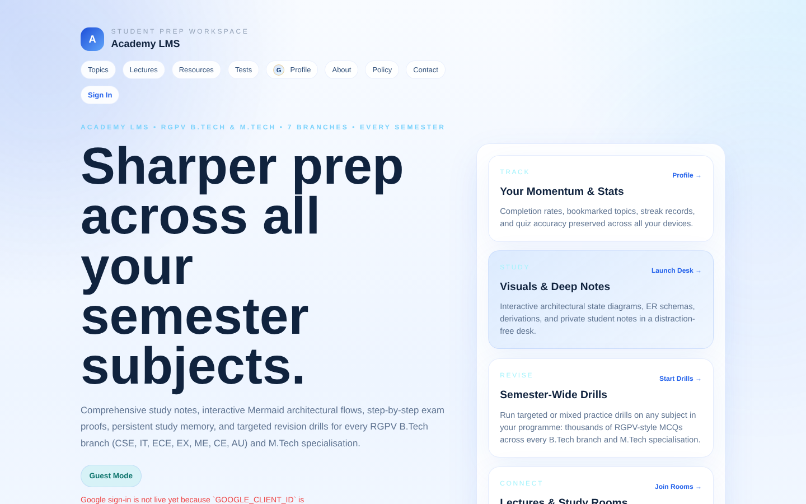{.screenshot}

## The programme picker

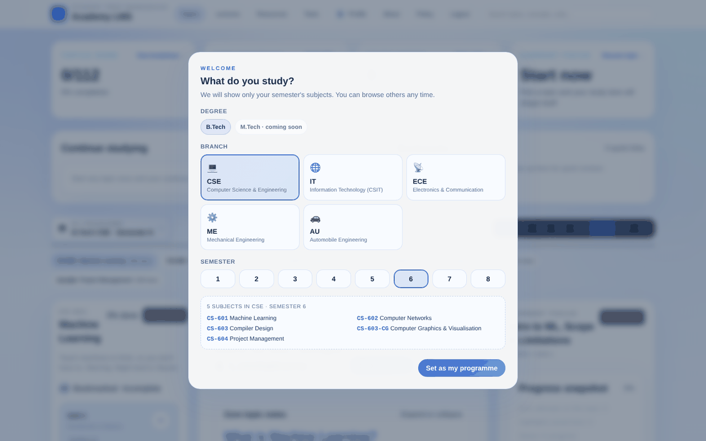{.screenshot}

The picker is the first thing a new student sees on the study desk. The preview at the bottom lists the semester's papers with their codes, so a student can check they have chosen correctly before saving. Branches with caveats, Automobile and the M.Tech programmes, show their note under the preview.

## The study desk

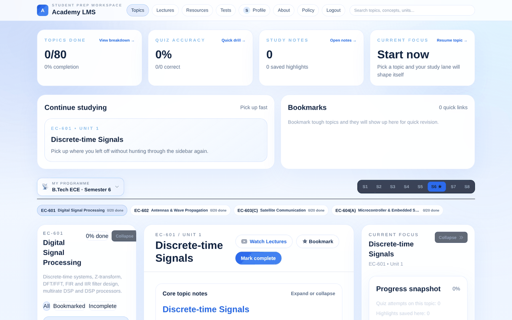{.screenshot}

The study desk has three regions. The navigation strip at the top holds the programme chip, the semester tabs and one pill per subject with its progress. The unit and topic list sits on the left, and the topic itself fills the centre. Overview cards above the strip show the student's progress, their quiz accuracy, a *Continue studying* shortcut to the last topic, and recent bookmarks.

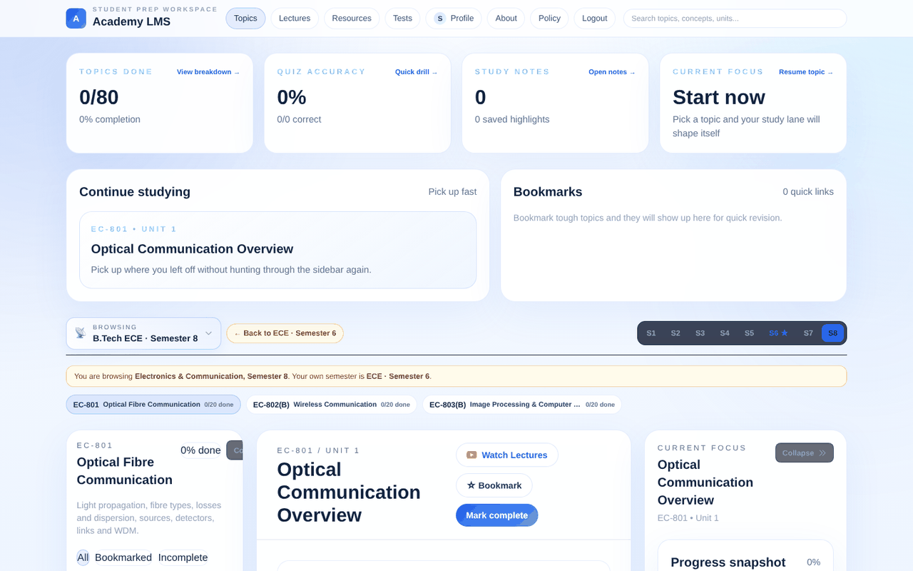{.screenshot}

## A topic page

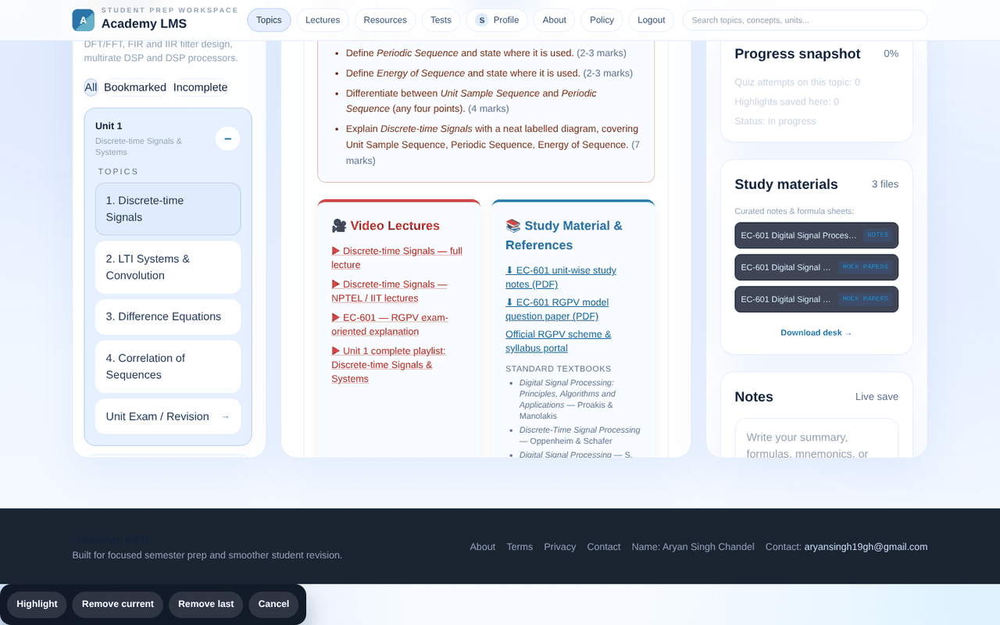{.screenshot}

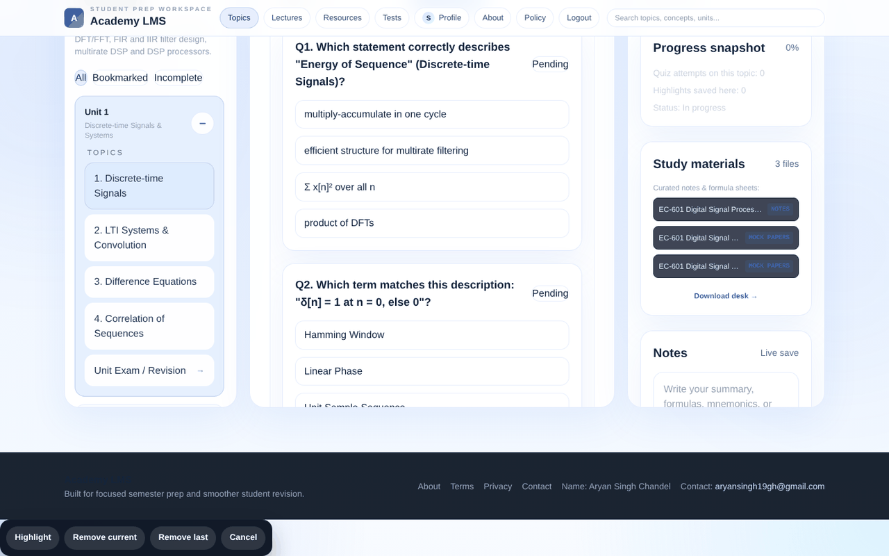{.screenshot}

## Practice, resources and lectures

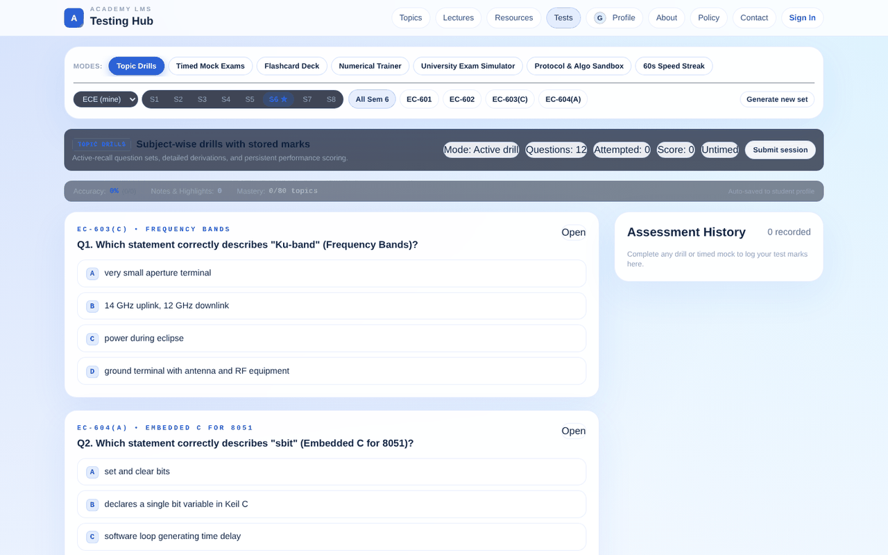{.screenshot}

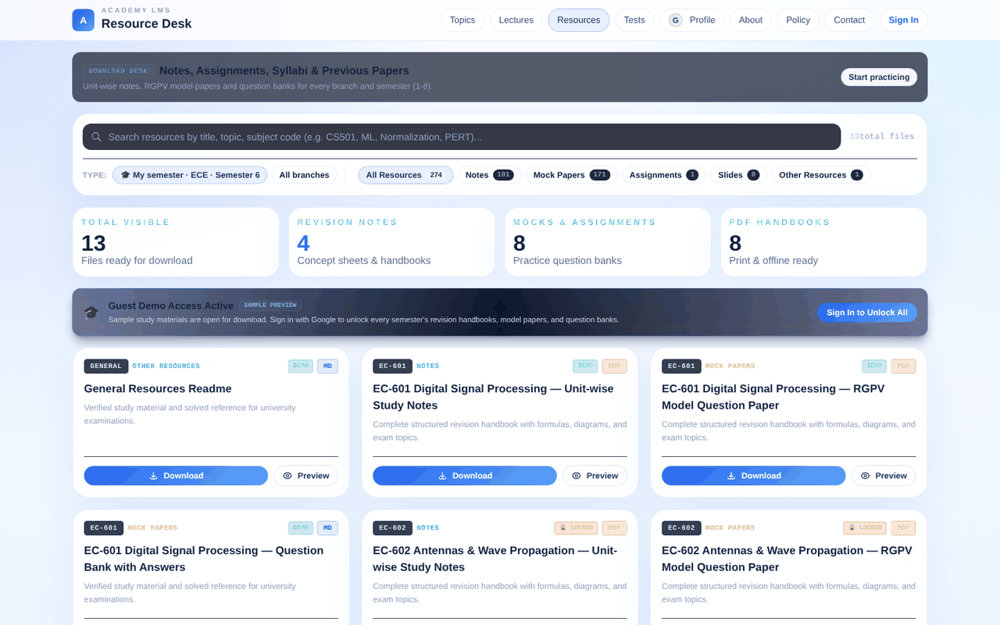{.screenshot}

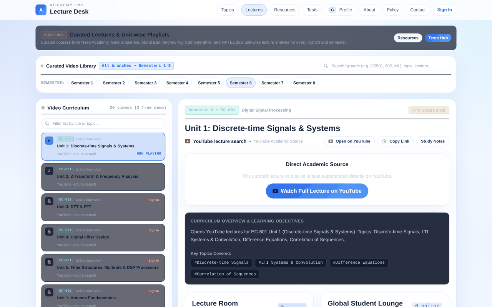{.screenshot}

## On a phone

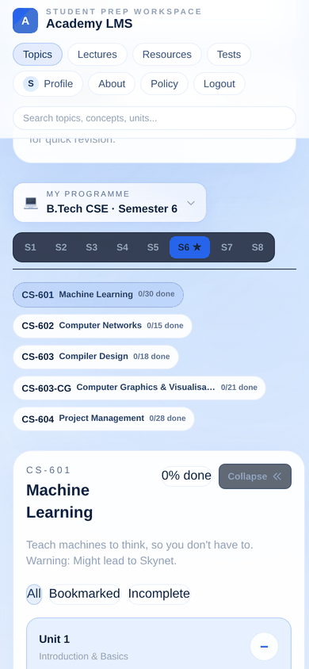{width=45%}

Every page is designed for a phone first. The navigation strip scrolls horizontally, the topic list folds into a drawer, and the tests page stacks its controls. The Android app shows exactly these pages, inside the WebView, with the animated splash in front of them while they load.

# Part V — Reflection {.part}

What the project taught me, what it adds up to, and where it goes next.

# 24. Struggles and lessons

## Building faster than I could organise

The 13th of May is the clearest example of a pattern that runs through the whole project. In one day I built a useful study tool, restyled it twice, added a database, and committed a lab computer's user profile to a public repository. Speed was the reason the project existed at all; nobody builds a study portal in the week before exams by planning carefully. But speed left debts: features that assumed a database was always present, a styling framework loaded from a CDN, a semester filter that did not scale, and history that will always contain `ntuser.dat`. Each debt was paid later, usually at a worse time.

The lesson is not "go slower". It is to know which decisions are cheap to change and which are not. Content, colours and copy are cheap. The shape of the stored state, the URL layout, what happens without the network and what is committed to a public repository are expensive, and those deserve ten minutes of thought even on a day when everything else is being done in ten seconds.

## Hand-written content does not scale, generated content needs care

The May and September subjects are the best pages on the site because every one was written by hand for an exam I was about to sit. They are also the reason version two needed a different approach: at that rate, every branch would have taken years. The curriculum language solved the scale problem, but it moved the risk. A hand-written page is wrong one page at a time; a generator is wrong everywhere at once. The validation in the generator, the CI check, the fixed seeds and the marked blocks are all answers to that risk, and I would add more: a check that every generated page renders, and a check that every link in the study material resolves.

## Assuming the happy path

Several of the worst bugs came from assuming that something would always be there: a database, a signed-in user, a recorded file size, a single semester, an internet connection. Each assumption was true when it was made and false a few months later. The mock store, the guest-first sign-in, the defensive state loading, the programme API and the offline bundles are all ways of making the unhappy path a normal path.

## Conveniences that become vulnerabilities

The admin secret that accepted `admin123` even in production is the bug I am least proud of, because it was not complicated. It was a convenience for testing that I never removed, in a repository where anyone could read it. I found it only because writing this book made me read every file again. Reading one's own code as a stranger would is the simplest security review available.

## Being honest about limits

The parts of version two I trust most are the ones that say what they are. The Automobile note says the scheme could not be verified. The model papers say they are practice papers. The lecture shelves say they are searches. A student who reads those labels can decide how much to rely on each part. An app that pretended to be complete would be more impressive for a day and less useful for a semester.

# 25. Principles I now follow

1. **Work without each dependency first.** Decide what the site does without the database, without sign-in, without the network and without JavaScript-heavy libraries, then add them.
2. **Separate content from code.** Content that changes often should be data that a script turns into code, not code that has to be edited by hand.
3. **Mark generated output.** A generator should own clearly marked regions, be safe to run twice, and be checked in CI.
4. **Store by subject, show by programme.** What a student has done belongs to the content; what a student sees belongs to their programme. Mixing the two makes switching destructive.
5. **Every default is a navigation decision.** Showing everything is not neutral; it is a choice to make students do the filtering.
6. **Ship the honest version.** Label generated, unverified and searched content as such.
7. **Small pull requests, even alone.** A change that can be described in one sentence can be reviewed, reverted and understood a year later.
8. **Review code as a stranger would.** Above all the sign-in and administration code, and above all before a release.

# 26. The project in numbers

| Measure | Value |
|---|---|
| Degrees | B.Tech (semesters 1–8) and M.Tech (semesters 1–2) |
| Branches and programmes | 7 B.Tech branches, 5 M.Tech programmes |
| Subjects | 163 (15 hand-written, 148 generated) |
| Topics | about 3,300 |
| Generated quiz questions | 8,880, plus the hand-written banks |
| Downloadable study files | notes PDF and Markdown, model paper PDF and Markdown, and a question bank for each of 148 subjects |
| Curriculum source | 14 text files, about 4,000 lines |
| Serverless functions | 12 API routes, about 20 database tables |
| Workflows | 8 (Android CI, release, Docker, curriculum check, static checks, link check, resource organiser, Play bundle) |
| Platforms | Web (Vercel), Windows (installer and portable), Android (APK, AAB-ready), Docker |
| Commits | about 670, of which 474 are the lab-profile accident |

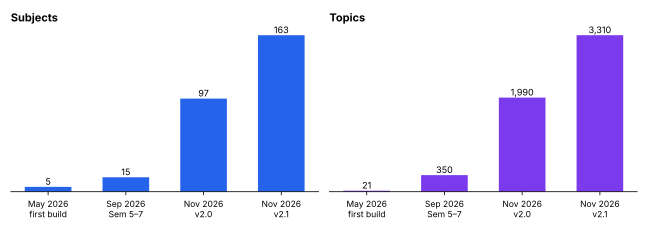

# 27. Where next

The roadmap in the repository is the authoritative list, but the direction is clear.

**Curated lectures.** Replace the generated search shelves with hand-picked playlists, starting with the most-studied subject of each branch, and invite students to suggest playlists through the existing upload and moderation flow.

**Numerical trainers for every branch.** The CSE trainers for subnetting, RSA and the critical path are the most popular part of the tests page. Mechanical students need thermodynamic cycles, Civil students need shear-force and bending-moment diagrams, Electronics students need filter design and Electrical students need per-unit calculations.

**Previous-year papers.** Link each subject to its real previous-year papers, with the model papers kept clearly separate.

**Offline that reconciles.** Merge offline and online progress automatically, and refresh the bundled content from the live site in the background.

**Google Play.** Grow the site's users, run the closed test with them, and publish. The launch kit is already in the repository.

**M.Tech semesters three and four** as electives become clearer, and more M.Tech specialisations: Communication, Production, Environmental and Data Science.

**Contributions from other students.** The curriculum language was designed so that someone who knows a subject well, but not JavaScript, can improve it by editing a text file and opening a pull request. The first outside contribution of that kind will be the real test of version two.

# Appendix A — Timeline {.unnumbered}

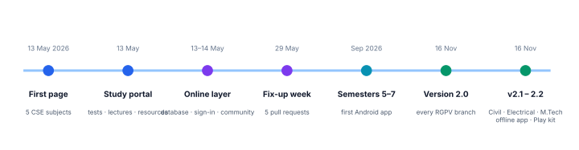


| Date | Event |
|---|---|
| 13 May 2026 | First version: `index.html`, `app.js`, `data.js`; five CSE semester-six subjects, 21 topics |
| 13 May 2026 | 474 accidental "Sync E:/UserProfile/…" commits from a lab computer, removed the same day |
| 13 May 2026 | Shared script, tests page, lectures and resources pages; light restyle; mock-test history; resource workflow; Neon-backed community features |
| 14 May 2026 | Admin dashboard, Blob uploads, admin allowlist, Google sign-in and moderation tools, workspace polish |
| 29 May 2026 | Five fix pull requests: Postgres typing, Blob SDK alignment, uploads and keyword checks, Tailwind build, lecture picker |
| 4 Sep 2026 | Local and mock-database mode, production Google client ID, first Android APK workflow, `vercel.json` |
| 9–13 Sep 2026 | Semester five; practice styles; lecture and resource libraries; optional authentication; guest merging; social connections; device bans; performance pass |
| 16 Nov 2026 | v2.0: curriculum language and generator; CSE, IT, ECE, ME, AU semesters 1–8; My Programme navigation; PDFs and model papers; APK and EXE releases; Docker; README, licence, changelog, privacy policy |
| 16 Nov 2026 | v2.1: Civil and Electrical; five M.Tech programmes; safe programme switching; landing-page fixes |
| 16 Nov 2026 | v2.1.1: app icons and animated splash screens for Android and Windows |
| 16 Nov 2026 | v2.2: offline Android app, Android 16 target, Play Store launch kit |
| 16 Nov 2026 | v2.2.1: admin authentication fix; this journey and the roadmap guide |

# Appendix B — Repository map {.unnumbered}

| Path | What it holds |
|---|---|
| `index.html` | Landing page and the study desk |
| `html/` | Tests, lectures, resources, profile, about, privacy, terms and contact pages |
| `admin/` | Admin dashboard |
| `js/shared.js` | The `window.ACADEMY` namespace: state, sync, sign-in, programme API, statistics |
| `js/app.js` | Study desk: navigation, programme picker, topic view, highlights, notes |
| `js/tests.js` | Drills, mock tests, flashcards, numerical trainers |
| `js/lectures.js`, `js/lecture-library.js` | Lecture player, chat and the playlist library |
| `js/resources.js`, `js/resource-library.js` | Resource page and its manifest |
| `js/profile.js` | Profile, statistics, export, social features |
| `js/data.js`, `js/data_<id>.js` | Curriculum outline and per-subject content |
| `api/` | Vercel serverless functions; `api/_lib/` holds shared helpers and the mock store |
| `assets/css/` | `tailwind.css` (built), `tailwind.input.css`, and `app.css` (the site's design) |
| `assets/resources/` | Curated and generated study files |
| `scripts/curriculum/` | The curriculum language files, `plan.js` and `references.js` |
| `scripts/` | Generators, the resource organiser and the Android bundler |
| `incoming_resources/` | Drop folder for files the organiser workflow sorts |
| `android/` | Native Android shell |
| `desktop/` | Electron Windows app |
| `docs/` | Screenshots, figures, Play Store kit, this journey and the roadmap guide |
| `tools/docs/` | The pandoc and Chromium pipeline that builds these PDFs |
| `.github/workflows/` | CI, release, Docker, curriculum, link and resource workflows |
| `server.js`, `Dockerfile`, `docker-compose.yml` | Local and container server |

# Appendix C — Glossary {.unnumbered}

**AAB.** Android App Bundle, the format Google Play requires instead of an APK.

**Adaptive icon.** An Android icon made of a foreground layer and a background that the launcher can mask into different shapes.

**Blob (Vercel Blob).** Vercel's file storage, used for avatars and student uploads.

**Browsing mode.** The study desk's state when it shows a semester other than the student's own, with a banner and a *Back* button.

**Curriculum language.** The plain-text format in `scripts/curriculum/*.txt` from which generated subjects are built.

**Electron.** A framework that packages a web app with Chromium and Node.js as a desktop program.

**Generator.** `build_multibranch_curriculum.js` and `build_study_resources.js`, which turn the curriculum language into site data and study files.

**Guest.** A visitor who has not signed in, identified by a random device ID.

**ID token.** A signed token from Google that identifies an account, verified on the server at sign-in.

**Marked block.** A region of a file between `<<…:START>>` and `<<…:END>>` comments that a generator owns and rewrites.

**Mermaid.** A library that draws diagrams from text descriptions in the browser.

**Mock store.** The in-memory imitation of the database used when no `DATABASE_URL` is configured.

**Neon.** A hosted serverless PostgreSQL service, used as the site's database.

**Paper code.** RGPV's identifier for a paper, such as CS-601 or CE-702(B).

**Placement.** A (branch, semester, code) triple saying where a subject appears in a programme.

**Programme.** A student's degree, branch and semester; the default scope of every page.

**RGPV.** Rajiv Gandhi Proudyogiki Vishwavidyalaya, the state technical university of Madhya Pradesh.

**Serverless function.** Code that runs on demand for one request, used for the `/api` routes on Vercel.

**Tailwind CSS.** A utility-class CSS framework, built at development time into `assets/css/tailwind.css`.

**WebView.** An Android component that displays web content inside an app.

**WebViewAssetLoader.** An AndroidX helper that serves files bundled in an app over a virtual HTTPS origin.
