# About this guide {.unnumbered}

Thank you for taking an interest in Academy LMS. This guide explains, in one place, how the project was built and how it works today. I have written it for three groups of readers:

- **Students and visitors** who use the site and would like to understand what happens behind it. Part I (the roadmap) and the *In plain terms* boxes at the start of each part are written for you, and assume no programming knowledge.
- **Developers and contributors** who want to run the project, fix something or add a branch. Parts II to VI describe every component in detail, with the exact files, settings and commands involved.
- **Teachers and reviewers** who want to evaluate the design and the decisions behind it.

The companion book, *Academy LMS: The Journey*, tells the story of the project in the order it happened, including the mistakes. This guide is the reference: it is organised by component rather than by date.

## The project at a glance {.unnumbered}

Academy LMS is a free study portal for students of Rajiv Gandhi Proudyogiki Vishwavidyalaya (RGPV). It covers seven B.Tech branches across all eight semesters and five M.Tech programmes, with notes, diagrams, quizzes, mock tests, lectures and downloadable study material for every subject.

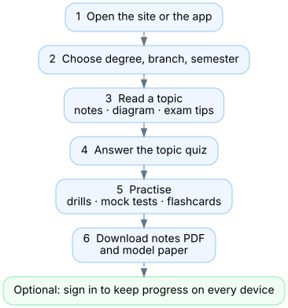

Behind the pages, a small number of services do the work:

| Service | Role in Academy LMS |
|---|---|
| **Vercel** | Hosts the website and runs the small server programs (the API) |
| **Neon** | Hosted PostgreSQL database that stores accounts, progress and community posts |
| **Vercel Blob** | Stores files that students upload |
| **Google Sign-In** | Lets students sign in with their Google account, without a new password |
| **YouTube** | Plays lectures inside the site through YouTube's standard embedded player |
| **GitHub** | Holds the source code, builds the Android and Windows apps automatically, and publishes releases |

## How this guide is organised {.unnumbered}

| Part | Topic | Best for |
|---|---|---|
| I | Roadmap: what was built, when, and what comes next | Everyone |
| II | The system at a glance: services, folders, running the project | Developers |
| III | The front end: the pages, saved progress, the study desk, practice, lectures, styling | Developers |
| IV | Content: how subjects are written and turned into pages and PDFs | Contributors |
| V | The back end: server functions, database, sign-in, uploads, moderation, security | Developers |
| VI | Apps and automation: Android, Windows, releases and quality checks | Developers |

Technical terms are explained when they first appear, and collected in the glossary at the end.

<div class="pagebreak"></div>

# Part I — Roadmap {.part}

What was built, in what order, and what comes next.

# 1. Stages at a glance

::: {.callout data-title="In plain terms"}
Academy LMS started on 13 May 2026 as a single page covering five sixth-semester Computer Science subjects. Within a day it had practice tests, a lecture page and a database. Over the summer it gained sign-in, a community area and a first Android app. In November 2026 it grew to cover every RGPV B.Tech branch and five M.Tech programmes, with Windows and Android apps that also work offline.
:::

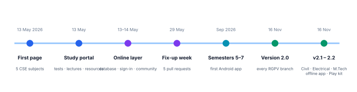

Each stage below lists what was built, the files involved, and the lesson it left behind. All dates come from the project's version history on GitHub.

# 2. Completed stages

## ✅ Stage 0 — The first page (13 May 2026)

| Step | What | Files |
|---|---|---|
| 0.1 | Single page with the Tailwind CDN and a dark "Linear" theme | `index.html` |
| 0.2 | Five CSE semester-six subjects, 21 topics: outline in one array, content in a second object | `data.js` |
| 0.3 | Subject tabs, unit sidebar, topic view, Mermaid diagrams, completed topics in `localStorage` | `app.js` |

**Lesson.** A plain page with data in JavaScript can be useful within hours, and opens from a USB stick as well as from a server.

## ✅ Stage 1 — The study portal (13 May 2026)

| Step | What | Files |
|---|---|---|
| 1.1 | Split into pages that share one script: study desk, tests, lectures, resources, profile | `js/shared.js`, `js/app.js`, `html/*.html` |
| 1.2 | Single state object saved on every change; device ID; statistics | `js/shared.js` |
| 1.3 | Topic drills, timed mock tests with history, flashcards, numerical trainers | `js/tests.js` |
| 1.4 | Light blue restyle; design moved into its own stylesheet | `assets/css/app.css` |
| 1.5 | Profile page and the first resource upload workflow | `js/profile.js`, `scripts/organize_resources.js` |
| 1.6 | Clean-up of the accidental lab-profile commits | — |

**Lesson.** Check `git status` before the first push. A public repository should be boring at its root.

## ✅ Stage 2 — The online layer (13–14 May 2026)

| Step | What | Files |
|---|---|---|
| 2.1 | Neon Postgres through the serverless driver; tagged-template queries | `api/_lib/db.js` |
| 2.2 | Profile and state sync | `api/profile.js` |
| 2.3 | Topic comments, lecture rooms with presence, direct messages | `api/topic-comments.js`, `api/lecture-chat.js`, `api/messages.js` |
| 2.4 | Admin dashboard, admin email allowlist, reports and bans | `admin/`, `api/admin.js`, `api/report-user.js` |
| 2.5 | Direct browser uploads to Vercel Blob | `api/blob-upload.js` |
| 2.6 | Google sign-in and moderation tools | `api/auth-*.js` |

**Lesson.** Decide what the site does without the database before depending on it. That decision arrived only in Stage 4.

## ✅ Stage 3 — The fix-up week (29 May 2026)

| PR | Fix |
|---|---|
| #1 | Postgres parameter typing in the Google sign-in query |
| #2 | Vercel Blob client and server SDK versions aligned |
| #3 | PowerPoint uploads, size-formatting crash, PDF keyword check for uploaded solutions |
| #4 | Resources page auth bootstrap; Tailwind CDN replaced by a built stylesheet |
| #5 | Searchable multi-subject lecture picker |

**Lesson.** Small pull requests, even when working alone, keep the history readable and changes reversible.

## ✅ Stage 4 — Semesters five and seven, and the first app (September 2026)

| Step | What |
|---|---|
| 4.1 | In-memory mock database when `DATABASE_URL` is missing; the site runs anywhere with no setup |
| 4.2 | Production Google client ID; first Android WebView APK workflow; `vercel.json` |
| 4.3 | Semester five (5 subjects) and semester seven (5 subjects): 15 subjects, about 350 topics |
| 4.4 | Rebuilt lecture library (playlist drawer) and resource library |
| 4.5 | Sign-in made optional; guest accounts merged into Google accounts on sign-in |
| 4.6 | Social connections; device bans; admin dashboard |
| 4.7 | Performance pass: gzip, cached config and session, preloading, hover prefetch |

**Lesson.** A filter that works for three semesters of one branch is not navigation.

## ✅ Stage 5 — Version 2.0: every branch, every semester (16 November 2026)

| Step | What |
|---|---|
| 5.1 | Curriculum language (`scripts/curriculum/*.txt`), programme plan and textbook references |
| 5.2 | Generator: topic pages, outline block, seeded MCQs; validation and CI staleness check |
| 5.3 | Study files: notes PDF and Markdown, two-set model paper, question bank for every generated subject |
| 5.4 | First year (BT-101 to BT-205) for all branches; CSE semesters 3, 4 and 8; IT, ECE, ME, AU semesters 3–8 |
| 5.5 | *My programme* navigation: picker, scoped desk, tests, resources, lectures, profile; browsing mode |
| 5.6 | Per-branch accent colour; light-theme contrast fixes for topic content |
| 5.7 | Release workflow (APK + Windows installer + portable EXE), Docker image, README, licence, changelog, privacy policy |

## ✅ Stage 6 — Versions 2.1 to 2.2.1 (16 November 2026)

| Version | What |
|---|---|
| 2.1.0 | Civil and Electrical branches; M.Tech CSE, VLSI, Thermal, Structural, Power Systems; working degree toggle; recent programmes; landing-page fixes |
| 2.1.1 | Launcher and Windows icons from the emblem; animated splash screens on Android and Windows |
| 2.2.0 | Offline Android app with bundled site; Android 16 target; signed release builds; Play Store launch kit |
| 2.2.1 | Admin authentication hardened; *The Journey* and this guide |

# 3. What comes next

| Priority | Item | Notes |
|---|---|---|
| High | Curated lecture playlists | Replace generated search shelves, starting with the most-studied subject of each branch |
| High | Google Play release | Closed test with 12+ testers for 14 days; launch kit in `docs/play-store/` |
| High | Automated tests | Unit tests for the generator and the programme API; a Playwright smoke test in CI |
| Medium | Numerical trainers for every branch | Thermodynamic cycles, SFD/BMD, filter design, per-unit calculations |
| Medium | Previous-year papers per subject | Clearly separated from generated model papers |
| Medium | Offline that reconciles | Merge offline and online progress; refresh the bundled content in the background |
| Medium | Spaced repetition for flashcards | Bring back cards marked "needs review" on a schedule |
| Low | More M.Tech specialisations, semesters 3–4 electives | Communication, Production, Environmental, Data Science |
| Low | Code-signed Windows build | Removes the SmartScreen warning |

# Part II — The system at a glance {.part}

The stack, the services, the repository, and how to run it.

# 4. Stack and services

::: {.callout data-title="In plain terms"}
The website is made of ordinary web pages that your browser downloads and runs. A few small programs on Vercel's servers (the *API*) save your progress and run the community features, using a database hosted by Neon. The Android and Windows apps show the same website inside an app window, and carry a copy of it for use without internet.
:::


| Layer | Technology | Why |
|---|---|---|
| Pages | Plain HTML5, one file per feature | Opens instantly on slow phones; no build step; works from `file://` |
| Logic | Vanilla JavaScript (ES2020), one shared namespace `window.ACADEMY` | No framework runtime; any page is readable from two files |
| Styling | Tailwind CSS 3 (built ahead of time) + `assets/css/app.css` | Utility classes for layout, a hand-written design layer for identity |
| Fonts | Manrope (UI) and IBM Plex Mono (code), from Google Fonts | Clean at small sizes; distinct monospace for codes |
| Diagrams | Mermaid, loaded only when a topic contains a diagram | Diagrams written as text, rendered in the browser |
| Content | `js/data.js` + `js/data_<id>.js`, generated from `scripts/curriculum/*.txt` | Plain-text authoring, lazy-loaded delivery |
| Study files | `pdfkit` with DejaVu fonts | Printable notes and model papers with engineering symbols |
| Hosting | Vercel: static files + Node.js serverless functions in `api/` | Free tier, Git-based deploys, functions next to the site |
| Database | Neon PostgreSQL via `@neondatabase/serverless` (HTTP queries) | Works from short-lived functions without a connection pool |
| Fallback DB | `api/_lib/mock-db.js`, an in-memory imitation | Site runs with zero configuration |
| File storage | Vercel Blob | Direct browser uploads with short-lived tokens |
| Sign-in | Google Identity Services + `google-auth-library` | No passwords to store; verified ID tokens |
| Lectures | YouTube's standard embedded player (`<iframe>`) on `youtube-nocookie.com` | No extra library needed; privacy-enhanced by default |
| Local / Docker server | Express 5 + `compression` (`server.js`) | Same API handlers as Vercel, one process |
| Android app | Native Java WebView shell, AndroidX `WebViewAssetLoader` | Live site online, bundled site offline |
| Windows app | Electron 33 + electron-builder (NSIS + portable) | Splash, icon, offline fallback |
| Automation | GitHub Actions (8 workflows) | CI, releases, Docker image, curriculum checks |
| Distribution | GitHub Releases (APK, EXE), GHCR (Docker image), Vercel (web) | — |

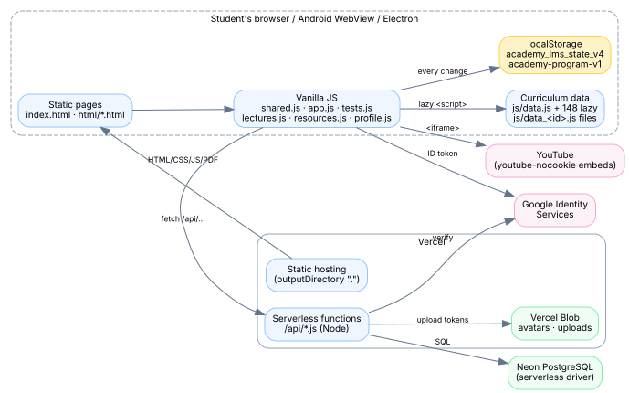

## Who does what

- **GitHub** hosts the repository, runs every workflow, stores the release files and publishes the Docker image to `ghcr.io`. It does not serve the website.
- **Vercel** is connected to the GitHub repository. Every push to `main` triggers a deploy: Vercel copies the repository root as static files (because `vercel.json` sets `"outputDirectory": "."` and there is no build command), and turns every `api/*.js` file into a serverless function at `/api/<name>`. Files in `api/_lib/` are helpers, not routes, because of the leading underscore. Pull requests get preview deployments.
- **Neon** holds the database. Its connection string is the `DATABASE_URL` environment variable in Vercel's project settings.
- **Vercel Blob** stores uploaded files; its token is `BLOB_READ_WRITE_TOKEN`.
- **Google Cloud** holds the OAuth client whose ID is `GOOGLE_CLIENT_ID`; the production client ID is also the built-in default.

# 5. The repository

```
Academy-LMS/
├── index.html                 landing page + study desk (one page, two views)
├── html/                      tests, lectures, resources, profile, about, privacy, terms, contact
├── admin/                     admin dashboard (index.html, admin.js)
├── js/
│   ├── shared.js              window.ACADEMY: state, sync, auth, programme API, stats
│   ├── app.js                 study desk
│   ├── tests.js               drills, mock tests, flashcards, numerical trainers
│   ├── lectures.js            lecture player + chat; lecture-library.js = curated playlists
│   ├── resources.js           resource page; resource-library.js = manifest (partly generated)
│   ├── profile.js             profile, export, social
│   ├── data.js                course outline (hand-written + <<MULTIBRANCH>> block)
│   └── data_<id>.js           163 per-subject content files (15 hand-written, 148 generated)
├── api/                       Vercel serverless functions; api/_lib = helpers + mock DB
├── assets/
│   ├── css/                   tailwind.input.css → tailwind.css (built); app.css (design)
│   ├── images/                logo
│   └── resources/<id>/        notes, mock papers, assignments, slides per subject
├── scripts/
│   ├── curriculum/            *.txt syllabus files, plan.js, references.js
│   ├── fonts/                 DejaVu fonts for PDFs
│   ├── build_multibranch_curriculum.js
│   ├── build_study_resources.js
│   ├── organize_resources.js
│   └── bundle-android-site.js
├── incoming_resources/        drop folder sorted by the organiser workflow
├── android/                   native Android shell
├── desktop/                   Electron Windows app
├── docs/                      screenshots, figures, Play Store kit, journey, this guide
├── tools/docs/                pandoc + Chromium book pipeline
├── .github/workflows/         8 workflows
├── server.js                  Express server for local/Docker
├── Dockerfile, docker-compose.yml
├── vercel.json                { "outputDirectory": "." }
└── package.json               scripts and server dependencies
```

# 6. Running it

## Quick start

```bash
git clone https://github.com/Aryan-singh19/Academy-LMS.git
cd Academy-LMS
npm install
npm start                      # http://localhost:3000
```

With no `.env`, the server prints a warning and uses the in-memory mock store. Everything works: progress, comments, chat, the admin dashboard (secret `admin123` in this mode). Nothing persists across restarts.

For real accounts and sync, copy `.env.example` to `.env` and set `DATABASE_URL` (a Neon connection string), and optionally `GOOGLE_CLIENT_ID`, `ADMIN_SECRET`, `ADMIN_EMAILS` and `BLOB_READ_WRITE_TOKEN`. `server.js` reads `.env` itself without any library.

## Static only

Because every page is static, `python3 -m http.server` in the repository root also serves the whole study desk, tests and resources. Only the `/api` features (sync, sign-in, community) need the Node server.

## Docker

```bash
docker compose up --build      # http://localhost:3000
```

The image is two-stage: the first stage runs `npm ci --omit=dev`, the second copies `node_modules` and the site into a `node:20-alpine` image, runs as a non-root `academy` user, exposes port 3000 and health-checks `/api/app-config` every 30 seconds. `docker-compose.yml` loads `.env` if present.

## Deploying your own copy

1. Fork the repository and import it into Vercel. No framework preset and no build command are needed.
2. Create a Neon project and copy its connection string into Vercel as `DATABASE_URL`.
3. Create an OAuth client in Google Cloud (type: Web), add your Vercel domain as an authorised JavaScript origin, and set `GOOGLE_CLIENT_ID`.
4. Set `ADMIN_SECRET` (12+ random characters) and `ADMIN_EMAILS`.
5. Optionally create a Blob store in Vercel and set `BLOB_READ_WRITE_TOKEN`.
6. Push to `main`. Vercel deploys within a minute.

# Part III — The front end {.part}

Pages, the shared script, state, and every feature a student touches.

# 7. Pages and the shared script

::: {.callout data-title="In plain terms"}
Everything you see is built in your browser. Your progress, notes and highlights are saved on your own device first, so the site works without an account. If you sign in, a copy is also saved online so it follows you to other devices. Choosing your branch and semester once makes every page show only your subjects.
:::


## Page lifecycle

Every page follows the same order:

1. `assets/css/tailwind.css`, Google Fonts and `assets/css/app.css` load in the `<head>`. Pages that offer sign-in also load Google's `gsi/client` script asynchronously.
2. At the end of `<body>`, `js/data.js` (pages that need the curriculum), then `js/resource-library.js` (where needed), then `js/shared.js`, then the page's own script.
3. `shared.js` builds `window.ACADEMY`, loads the state from `localStorage`, renders the navigation bar, starts the hover prefetcher and, in the background, loads the app configuration and the session.
4. The page script initialises on `DOMContentLoaded` and subscribes to `academy:state-changed` and `academy:program-changed`.

## The `window.ACADEMY` API

| Group | Functions |
|---|---|
| State | `state`, `persistState`, `markTopicComplete`, `recordQuizAttempt`, `recordPracticeSession`, `getPracticeSessions`, `setNote` / `getNote`, `addHighlight` / `removeHighlight` / `getHighlights` / `clearHighlights` / `applyHighlights`, `toggleBookmark` / `isBookmarked` / `getBookmarkedTopics`, `setExamDraft` / `getExamDraft`, `setLastVisited`, `getRecentTopics`, `getContinueTopic` |
| Curriculum | `getAllTopics`, `getTopicMeta`, `getUnitMeta`, `getLoadedQuestionBank`, `loadCourseScripts(ids, basePath)` |
| Programme | `getProgram`, `setProgram(branch, semester)`, `hasStoredProgram`, `getBranches`, `getBranchPlan`, `getSemestersFor(branch)`, `getPlanEntries(branch, semester)`, `getPlacements(courseId)`, `findPlacement(courseId, preferBranch, preferSemester)`, `getDisplayCode`, `getProgramLabel`, `getRecentPrograms`, `getDegree` |
| Statistics | `calculateStats`, `getStorageSummary`, `exportStudentSnapshot` |
| Sync | `scheduleCloudSync`, `syncStateToCloud`, `getRemoteSyncStamp`, `setRemoteSyncStamp` |
| Auth | `loadAppConfig`, `getAppConfig`, `hydrateAuthSession`, `getSignedInStudent`, `isAuthenticated`, `isAdmin`, `signInWithGoogle`, `logoutStudent`, `showSignInPrompt`, `requireStudentAuth`, `buildSigninRedirect` |
| Profile | `getStudentName` / `setStudentName`, `getProfileAvatar` / `setProfileAvatar` |
| Utilities | `escapeHtml`, `escapeForAttribute`, `escapeRegExp` |

## Events

| Event | Fired by | Detail | Listened to by |
|---|---|---|---|
| `academy:state-changed` | `persistState` | `{ updatedAt, remoteSync }` | study desk, profile, navigation badges |
| `academy:program-changed` | `setProgram` | `{ branch, semester }` | study desk, tests, resources, lectures, profile |

# 8. State and storage

## Keys in `localStorage`

| Key | Contents |
|---|---|
| `academy_lms_state_v4` | The student's whole study state (below) |
| `academy-program-v1` | `{ branch, semester }`, default `{ branch: 'CSE', semester: 6 }` |
| `academy-recent-programs-v1` | The last four programmes, newest first |
| `academy_admin_secret` | Admin dashboard only: the secret, if one was typed |

`sessionStorage` caches the app configuration and the auth session between pages (`academy_cached_config`, `academy_cached_auth`) and is revalidated in the background.

## The state object

| Field | Shape | Meaning |
|---|---|---|
| `completedTopics` | `{ <topicKey>: true }` | Topics marked complete |
| `quizAttempts` | keyed by quiz → `{ courseId, topicId, question, selected, correct, attemptedAt }` | Topic quiz answers |
| `notes` | keyed by topic → text | Notes typed under a topic |
| `highlights` | keyed by topic → `[text, …]` | Highlighted passages |
| `bookmarks` | keyed by topic → `true` | Bookmarked topics |
| `examDrafts` | keyed by unit → text | Long-answer drafts |
| `practiceSessions` | newest first, last 20 kept; each session plus `finishedAt` | Drill and mock history |
| `recentTopics`, `lastVisited` | topic keys | *Continue studying* |
| `studentName`, `avatarUrl` | strings | Profile |
| `deviceId` | UUID | Guest identity on the server |
| `profileStartedAt`, `updatedAt` | ISO timestamps | — |
| `remoteSync` | `{ lastSyncedAt, lastStatus, lastMessage }` | Last cloud sync |

`loadState` merges the stored JSON over defaults, fills a missing `deviceId`, and starts fresh if the JSON cannot be parsed. Progress is keyed by subject and topic, never by programme, which is why switching programme never loses work.

## Cloud sync timing

| Constant | Value | Effect |
|---|---|---|
| `FOREGROUND_SYNC_DELAY_MS` | 2,200 ms | Delay after a change while the page is visible |
| `BACKGROUND_SYNC_DELAY_MS` | 9,000 ms | Delay while the page is hidden |
| `MIN_SYNC_GAP_MS` | 12,000 ms | Minimum gap between two syncs |

A sync posts the state to `/api/profile`, which stores a snapshot and derived rows (topic progress, quiz attempts, practice sessions).

# 9. The study desk

## Loading

`js/app.js` starts with `initApp`: it renders the overview cards and the navigation strip, aligns the view with the stored programme (`alignViewWithProgram`), loads the first subject's detail file with `loadCourseData`, renders it, then preloads the remaining subjects *of the current view only*. On a first visit, with no stored programme, it opens the programme picker; with `?pick=1` in the URL (the profile page's *Change programme* link), it opens the picker too.

`loadCourseData(id)` inserts `<script src="js/data_<id>.js" data-course-script="<id>">`, waits for `onload`, and shows an error card on `onerror`. Already-loaded subjects are remembered so no file is fetched twice.

## Navigation state

The desk keeps `viewBranch` and `viewSemester` separately from the stored programme. When they match the programme, the desk is in *my programme* mode; when they do not, it is in *browsing* mode and renders a banner with a *Back to* button (`returnToMyProgram`). `renderCoursesNav` draws the programme chip, the semester tabs (the student's own semester starred) and one pill per subject with *done/total*. It also sets `document.documentElement.dataset.branch`, which drives the accent colour.

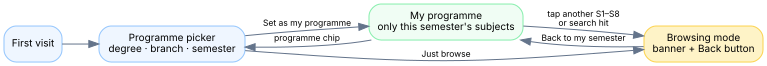

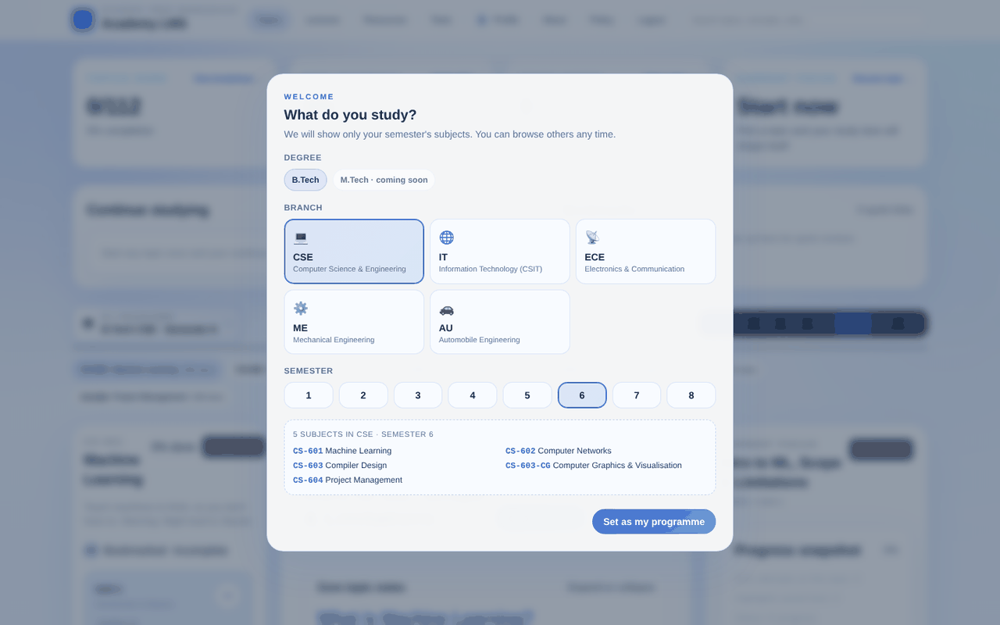{.screenshot}

## The programme picker

`openProgramPicker({ firstRun })` builds a modal (`#programPickerModal`) with a degree toggle (B.Tech / M.Tech, filtering branches by `branch.degree`), a *Recent* row, the branch grid, the semester row and a live preview from `getPlanEntries`. *Set as my programme* calls `setProgram`; *Just browse this semester* only changes the view. The first-run picker cannot be dismissed without choosing.

## Topic rendering

A topic's HTML comes from `window.topicDetails[unitId][topicId].content` and is inserted into `#topicContentArea`. Then:

1. If the content contains `.mermaid`, Mermaid is loaded once (from jsDelivr), initialised with `startOnLoad: false` and `theme: 'base'`, and run over the new diagrams.
2. Saved highlights are re-applied (`applyHighlights`), by searching the rendered text for each stored passage.
3. The notes box, bookmark toggle and *mark complete* button are bound to the topic key.
4. The quiz, from `.quizzes`, is rendered below, and answers are saved with `recordQuizAttempt`.

## Highlights toolbar

Selecting text inside the topic shows `#selectionActionMenu` with *Highlight*, *Remove current*, *Remove last* and *Cancel*. It is hidden with Tailwind's `hidden` class; `app.css` includes `.selection-menu.hidden { display: none; }`, because the menu's own `display: flex` would otherwise override `hidden`.

# 10. Practice (`html/tests.html`, `js/tests.js`)

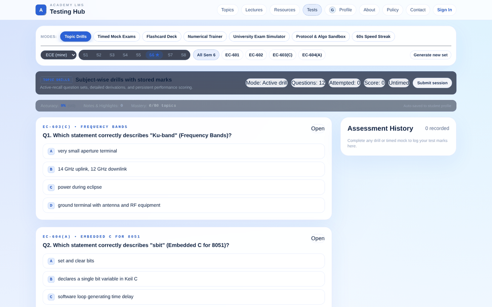{.screenshot}


| Feature | How it works |
|---|---|
| Question bank | `buildPracticeBank` collects every quiz from loaded subjects; filtered to the programme's semester (`getTestEntries`) |
| Branch / semester controls | `#testBranchSelect`, `#semFilterGroup`, `#coursePillContainer`; changing semester loads its subject files with `loadCourseScripts` |
| Topic drills | `buildPracticeSession('drill')`; instant feedback per answer |
| Timed mock exams | `startMockTest(minutes)`; countdown; `submitCurrentSession(autoSubmitted)` when time runs out |
| History | Each session saved with `recordPracticeSession`; listed by `renderPracticeHistory` |
| Flashcards | 25 random questions; flip; mark *mastered* or *needs review*; running counts |
| Numerical trainers (CSE) | Subnetting, RSA, Diffie–Hellman, critical path, parsing tables, DFA minimisation, FD closure, cellular reuse, HDFS placement, architecture; each generates a problem, verifies and reveals a solution |

# 11. Lectures (`html/lectures.html`, `js/lectures.js`)

## Embedding

The player is a plain `<iframe>`:

```html
<iframe id="lecturePlayerIframe" src="https://www.youtube-nocookie.com/embed/VIDEO?rel=0"
        loading="lazy" referrerpolicy="strict-origin-when-cross-origin"
        allow="accelerometer; autoplay; clipboard-write; encrypted-media; gyroscope; picture-in-picture; web-share"
        allowfullscreen></iframe>
```

The page uses YouTube's standard embedded player directly; no additional player library is involved, because the site only needs to display videos, not control them. A small function, `normalizeLectureUrl`, converts any stored YouTube link into the embedded form:

| Input | Embed URL |
|---|---|
| `youtube.com/watch?v=ID` | `/embed/ID?rel=0` |
| `youtube.com/watch?v=ID&list=PL` | `/embed/ID?list=PL&rel=0` |
| `youtu.be/ID` | `/embed/ID?rel=0` |
| `youtube.com/playlist?list=PL` | `/embed/videoseries?list=PL&rel=0` |
| an existing `/embed/` URL | host swapped to the current mode |
| `youtube.com/results?…` (search) | not embedded; opened as a link |

The host is `www.youtube-nocookie.com` by default (privacy-enhanced: no tracking cookies until playback) and `www.youtube.com` in *direct* mode, which a toggle switches to when a video refuses to play. *Reload player* blanks and restores the iframe.

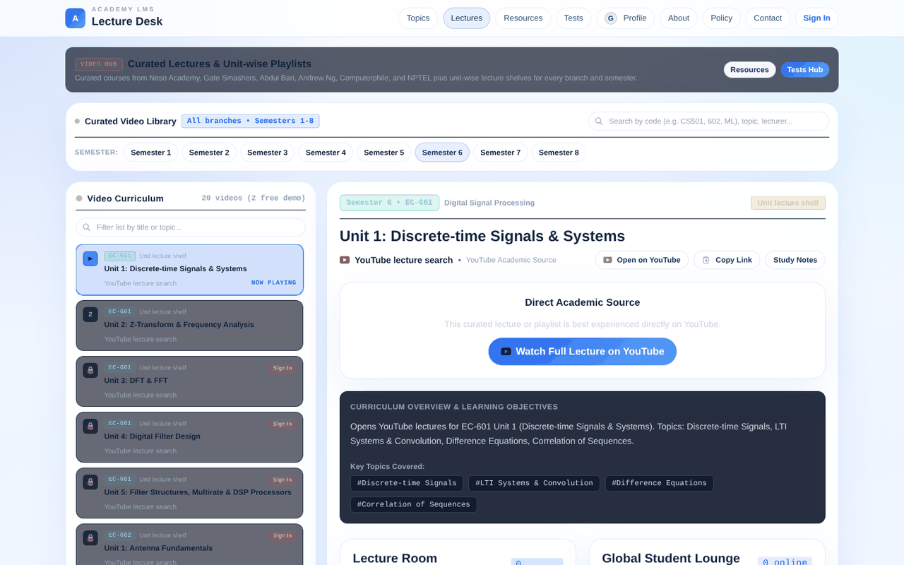{.screenshot}

## Library and shelves

`js/lecture-library.js` holds curated entries: `{ type: 'playlist' | 'video', subject, semester, title, channel, url, note }`. Generated subjects get unit-wise *shelves* of YouTube search links built from subject, unit and topic names. `lectureInActiveSemester` scopes the list to the programme.

## Lecture rooms

While a lecture is open, a timer sends a heartbeat (`sendLectureHeartbeat`) and fetches chat for two scopes, `local` (this lecture) and `global` (the lectures page), via `/api/lecture-chat`. It skips a tick if the tab is hidden or a previous request is still running. Messages are posted with `POST /api/lecture-chat`.

# 12. Resources (`html/resources.html`, `js/resources.js`)

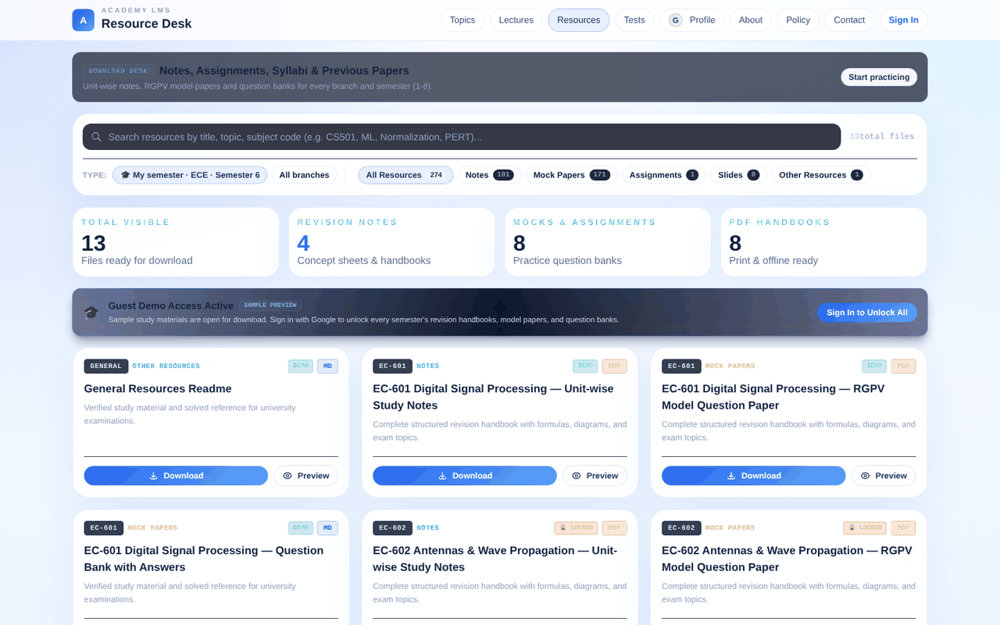{.screenshot}

`js/resource-library.js` is the manifest: an array of entries such as `{ subject, subjectLabel, type, typeLabel, title, path, extension, branches, semesters, generated }`. Its hand-curated part is rewritten by `organize_resources.js`; its generated part lives between `// <<MULTIBRANCH-RESOURCES:START>>` and `// <<MULTIBRANCH-RESOURCES:END>>`. The page has two scopes, *My semester* (default, `resourceInMyProgram`) and *All*, plus type filters (notes, mock papers, assignments, slides) and search. Signed-in students can also upload, see Chapter 19.

# 13. Profile (`html/profile.html`, `js/profile.js`)

The profile shows identity (name, avatar, bio, headline, links), statistics from `calculateStats` scoped to the programme, course coverage with a *Change programme* link (`../index.html?view=study&pick=1`), recent activity, the export button (`exportStudentSnapshot`, a JSON file whose `topicDirectory` includes only touched topics), and the social panel: connection requests, connections and direct messages.

# 14. Styling

## Layers

1. **Tailwind CSS 3**, built ahead of time. `tailwind.config.cjs` scans `index.html`, `html/**/*.html`, `js/**/*.js` and `admin/**/*.{js,html}`, and sets Manrope as the sans font. `assets/css/tailwind.input.css` contains the three `@tailwind` directives. `npm run build:tailwind` writes the minified `assets/css/tailwind.css`, which is committed so the site has no deploy-time build.
2. **`assets/css/app.css`** (about 1,380 lines) loads after Tailwind and defines the identity:
   - custom properties: `--bg`, `--panel`, `--line`, `--text`, `--muted`, `--accent` (#2563eb), `--warm`, `--danger`
   - the light background, radial gradients over a pale blue linear gradient
   - components: `.panel-card`, `.metric-card`, `.course-pill(-active)`, `.nav-pill`, `.primary-cta`, `.secondary-cta`, `.quiz-option-*`, `.flashcard-*`, `.chat-bubble-*`, `.program-chip`, `.pick-*`, `.browse-*`, `.modal-shell`, `.progress-bar`
   - motion: `.rise-in`, `.reveal`

## Light theme over dark content

The original topic content was written for the dark May theme, with classes such as `bg-gray-800/90` and `text-gray-300`. Rather than rewrite 15 subjects, `app.css` re-maps those classes inside `#topicContentArea` to light panels and dark text. Generated topics use the same classes, so they inherit the same mapping.

## Branch accents

```css
html[data-branch] { --branch-accent: #2563eb; }          /* CSE */
html[data-branch="IT"] { --branch-accent: #0891b2; }
html[data-branch="EC"] { --branch-accent: #7c3aed; }
html[data-branch="EX"] { --branch-accent: #ca8a04; }
html[data-branch="ME"] { --branch-accent: #ea580c; }
html[data-branch="CE"] { --branch-accent: #b45309; }
html[data-branch="AU"] { --branch-accent: #059669; }
html[data-branch^="MT-"] { --branch-accent: #4f46e5; }   /* all M.Tech */
```

The accent colours the programme chip's border, the active subject pill and topic headings. Layout, components and type are identical across branches.

## Rules for new markup

- Use complete Tailwind class names in source; never build them from fragments, or the scanner will not see them.
- Rebuild Tailwind after adding classes in any scanned file: `npm run build:tailwind`.
- Put identity (colours, components) in `app.css`, layout in Tailwind.

# Part IV — Content {.part}

How the curriculum is stored, written and generated, and how to add to it.

# 15. Data formats

::: {.callout data-title="In plain terms"}
Subjects are written as simple text files that read like revision notes: a subject, its units, and for each topic a short summary and its key terms. A program then turns those files into the topic pages, quizzes, notes PDFs and model papers you see on the site. This is how a small team can cover more than 160 subjects, and how anyone who knows a subject well can correct it without knowing how to program.
:::


## The outline: `coursesData`

`js/data.js` defines `const coursesData = [ … ]`. Each course:

```js
{
  id: 'ce601',                        // unique, lower-case; also the data file name
  code: 'CE-601',                     // default paper code
  title: 'Structural Design & Drawing (RCC-I)',
  description: '…',
  semester: 6,                        // primary semester (hand-written courses)
  generated: true,                    // only on generated courses
  references: [['Title', 'Author'], …],
  resources: { notesPdf, notesMd, paperPdf, paperMd, bankMd },
  units: [
    { id: 'ce601-u1', unitNumber: 1, title: 'Design Philosophies',
      topics: [ { id: 'ce601-u1t1', title: 'Working Stress vs Limit State' }, … ] },
    …
  ]
}
```

The generated block at the end of `data.js`, between `// <<MULTIBRANCH:START>>` and `// <<MULTIBRANCH:END>>`, pushes the generated courses and defines:

```js
window.BRANCHES = { CSE: { degree: 'B.Tech', name: 'Computer Science & Engineering',
                           short: 'CSE', icon: '💻' }, …, 'MT-PS': { degree: 'M.Tech', … } };
window.branchPlan = { CSE: { 1: [{ id: 'bt101', code: 'BT-101' }, …], …, 8: [ … ] }, … };
```

## The content: `topicDetails`

Each `js/data_<id>.js` adds to a global object:

```js
window.topicDetails = window.topicDetails || {};
window.topicDetails['ce601-u1'] = window.topicDetails['ce601-u1'] || {};
window.topicDetails['ce601-u1']['ce601-u1t2'] = {
  title: 'Limit States',
  content: '<h3 …>Limit States</h3> …',   // HTML string
  quizzes: [ { question, options: [4 strings], answer: index, explanation } ]
};
```

Hand-written files use the same shape, with hand-written HTML and quizzes.

# 16. The curriculum language

## Grammar

```
file     := { comment | subject }
comment  := "//" text
subject  := "@ " id " | " code " | " title " | " description NEWLINE { unit }
unit     := "# " title NEWLINE { topic }
topic    := "- " title " | " overview { " | " term " = " definition }
```

Rules:

1. `|` separates fields and **must never appear inside text**. Write "magnitude of V" rather than `|V|`.
2. A term ends at the **first** ` = ` (space, equals, space); the definition may contain further `=` signs, as in `Gibbs Function = g = h − Ts`.
3. Each topic should have at least three terms. Fewer than four terms across a subject makes MCQ distractors impossible.
4. IDs are lower-case and unique across all files. Electives use a suffix: `ce702a`, `me503-mt`.
5. Every subject has five units of four topics by convention. The generator does not enforce counts, but the model paper assumes five units.

## Files

| File | Contents |
|---|---|
| `00-first-year.txt` | BT-101 to BT-105, BT-201 to BT-205 |
| `01-common.txt` | ES-301 Energy & Environmental Engineering, BT-301 Mathematics-III |
| `02-cse-sem3.txt`, `03-cse-sem4.txt` | CSE semesters 3 and 4 |
| `04-cse-sem8-it.txt` | CSE semester 8 and IT-only papers |
| `05-ec-part1.txt`, `06-ec-part2.txt` | Electronics & Communication |
| `07-me-part1.txt`, `08-me-part2.txt` | Mechanical |
| `09-au.txt` | Automobile semesters 5–8 |
| `10-civil.txt` | Civil |
| `11-electrical.txt` | Electrical & Electronics |
| `12-mtech-a.txt` | Research Methodology & IPR, M.Tech CSE, M.Tech VLSI |
| `13-mtech-b.txt` | M.Tech Thermal, Structural, Power Systems |

## `plan.js`

```js
const BRANCHES = { CE: { degree: 'B.Tech', name: 'Civil Engineering', short: 'CE', icon: '🏗️' }, … };
const FIRST_YEAR = { 1: [e('bt101', 'BT-101'), …], 2: [ … ] };
const PLAN = {
  CE: { ...FIRST_YEAR,
        3: [e('bt301', 'BT-301'), e('ce302', 'CE-302'), …, e('me304', 'CE-305')],
        … },
  'MT-PS': { 1: [ … ], 2: [ …, e('ex702b', 'MPS-203'), e('mt-rm', 'MPS-204') ] }
};
```

`e(id, code)` is a placement. The same `id` may appear in many branches with different codes. An optional `note` on a branch is shown in the programme picker.

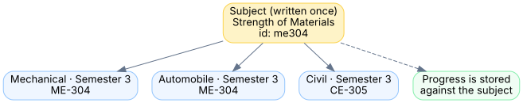

## `references.js`

`{ id: [[title, author], [title, author], [title, author]], … }`. Every generated subject must have an entry.

# 17. The curriculum generator

`node scripts/build_multibranch_curriculum.js` (or `npm run build:curriculum`, which also runs the study-file generator).

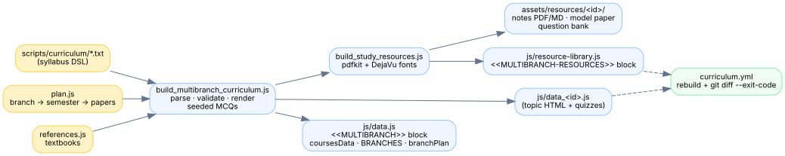

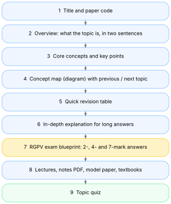

## Steps

1. **Parse** every `*.txt` in `scripts/curriculum/` in name order (`parseSources`). Errors name the file and line: unknown line prefix, missing fields, a term without ` = `, a duplicate ID.
2. **Validate the plan.** Every planned ID must exist; every subject must be planned somewhere; every subject must have references. Any failure stops the build.
3. **Find each subject's primary semester**, its first placement, used for display defaults.
4. **Render each topic** (`buildTopicHtml`) in the fixed template: heading and code line, overview, core-concept and key-point cards, a Mermaid concept map with previous and next topics, a revision table, an in-depth explanation, the RGPV exam blueprint (a 2–3 mark question per term, a 4-mark comparison of the first two terms, a 7-mark long answer), and study material: four YouTube searches (`ytSearch`), notes PDF, model paper, `rgpv.ac.in` and the three textbooks.
5. **Generate quizzes** (`buildQuizzes`): three per topic. Each is either term → definition or definition → term, alternating, with three distractors from the same subject. Randomness comes from `seededRandom(seedText)`, an FNV-1a hash of the subject and topic IDs feeding a small PRNG, so output is identical on every run.
6. **Write** `js/data_<id>.js` with a header naming the source file, and replace the marked block in `js/data.js`.
7. **Print** a summary: subjects, topics, MCQs.

The script exports `parseSources`, `resourcePaths`, `ytSearch` and `REFERENCES`, which the study-file generator reuses.

# 18. The study-file generator

`node scripts/build_study_resources.js` writes, for every generated subject, to `assets/resources/<id>/`:

| File | Content |
|---|---|
| `notes/<id>-unit-wise-study-notes.pdf` / `.md` | Every unit and topic: overview and terms, for printing |
| `mock-papers/<id>-rgpv-model-question-paper.pdf` / `.md` | Sets A and B: 3 hours, 70 marks, attempt any five of eight, each question two 7-mark parts; Markdown adds answer hints; labelled "not an official RGPV paper" |
| `mock-papers/<id>-question-bank-with-answers.md` | Unit-wise questions with answers |

Details:

- **Fonts.** `pdfkit` registers `scripts/fonts/DejaVuSans.ttf` and `DejaVuSans-Bold.ttf`, so ε, Ω, Δ, ≤ and similar render. The fonts' licence is in `LICENSE-DejaVu.txt`.
- **Determinism.** The PDF `CreationDate` is fixed, so unchanged content produces byte-identical PDFs.
- **Topic rotation.** `modelPaper(course, set)` picks topics by rotating through each unit, offset by the set, so sets A and B test different material.
- **Registration.** Every file is listed in `js/resource-library.js` between `// <<MULTIBRANCH-RESOURCES:START>>` and `:END>>`, with the branches and semesters that can see it.

# 19. The resource organiser

`scripts/organize_resources.js`, run by `organize-resources.yml` on every push to `main`:

1. Lists files in `incoming_resources/`.
2. Classifies each by subject (tokens such as `cs602`, `network`) and type (`notes`, `assignment`, `mock`, `slides`; otherwise `resources`).
3. Moves it to `assets/resources/<subject>/<type>/` with a slug name and builds a title from the filename.
4. Rewrites the hand-curated part of `js/resource-library.js`, **preserving the generated block** and skipping generated files.
5. The workflow commits the result as `github-actions[bot]`.

Running it twice changes nothing.

# 20. Recipes

## Fix a mistake in a generated topic

1. Find the subject's line in `scripts/curriculum/*.txt` (search for the topic title).
2. Edit the text. Keep the field rules.
3. Run `npm run build:curriculum`.
4. Commit the `.txt` change **and** the regenerated files. CI fails if you commit only one.

## Add a subject to an existing branch

1. Add an `@` block with five units to the right `.txt` file.
2. Add three references to `references.js`.
3. Add `e('newid', 'CODE')` to the branch's semester in `plan.js`.
4. `npm run build:curriculum`, then `npm run build:tailwind` (new markup may use new classes).
5. Open the study desk, pick that programme, open the subject, check a topic, the quiz, and the PDF links.

## Add a branch

1. Write `NN-branch.txt` with the branch's semester 3–8 subjects; reuse existing IDs where RGPV teaches the same subject.
2. Add references.
3. In `plan.js` add `BRANCHES.XX = { degree: 'B.Tech', name, short, icon, note? }` and `PLAN.XX = { ...FIRST_YEAR, 3: […], …, 8: […] }`.
4. Add an accent in `app.css`: `html[data-branch="XX"] { --branch-accent: #…; }`.
5. Build, check, and update the coverage table in `README.md`.

## Add an M.Tech programme

As a branch, with `degree: 'M.Tech'`, an ID starting `MT-` (so it picks up the M.Tech accent), semesters 1 and 2 only, and `e('mt-rm', '…-204')` in semester 2.

## Add a curated playlist

Add an entry to `js/lecture-library.js` with the subject ID, semester, title, channel and the playlist or video URL. `normalizeLectureUrl` handles the embed form.

# Part V — The back end {.part}

Serverless functions, the database, sign-in, uploads, moderation and security.

# 21. Serverless functions

::: {.callout data-title="In plain terms"}
When you save progress, post a comment or sign in, your browser sends a short request to a small program running on Vercel. That program checks who you are, stores or fetches the data from the Neon database, and replies. Your password is never involved: Google confirms your identity, and the site keeps only a random session key, stored in a form that cannot be reused even if the database were exposed.
:::


## How a request is handled

On Vercel, `api/profile.js` becomes `/api/profile`. Each file exports one `async function handler(req, res)`. Locally and in Docker, `server.js` maps `/api/:route` to the same exported handlers, so the code runs unchanged in both places. Express parses JSON bodies up to 15 MB.

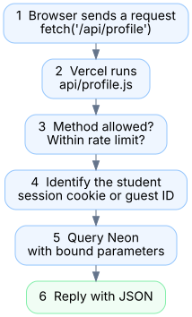

Every handler follows the same order:

1. `allowMethods(req, res, ['GET', 'POST'])` returns `405` for anything else.
2. `applyRateLimit(req, res, { scope, limit, windowMs })` returns `429` when a client exceeds its budget.
3. `getSql()` returns the Neon driver or the mock store.
4. Identity: `getStudentFromSession(req, sql)` for signed-in students, or the `deviceId` in the request for guests; banned students and devices are rejected (`assertStudentAllowed`).
5. Queries run as tagged templates, `` sql`… ${value} …` ``, so every value is a bound parameter.
6. `sendJson(res, status, body)` replies.

## Routes

| Route | Methods | Purpose | Rate limit (per minute) |
|---|---|---|---|
| `/api/app-config` | GET | Google client ID; whether Blob uploads are enabled | — |
| `/api/auth-google` | POST | Verify Google ID token, create or update the student, merge guest data, create session | 20 |
| `/api/auth-session` | GET | Return the signed-in student, if any | 80 |
| `/api/auth-logout` | POST | Delete session, clear cookie | 30 |
| `/api/profile` | GET, POST | Read profile and stats; save profile and synced state | 90 GET / 45 POST |
| `/api/topic-comments` | GET, POST | Comments on a topic; counts | 120 / 60 |
| `/api/lecture-chat` | GET, POST | Lecture-room messages and presence, local and global scopes | 120 / 90 |
| `/api/messages` | GET, POST | Direct messages between connected students | 90 / 40 |
| `/api/social` | GET, POST | Connections: request, accept, reject, cancel, disconnect | 100 / 40 |
| `/api/blob-upload` | POST | Issue Blob upload tokens; record completed uploads; PDF keyword check | 20 |
| `/api/report-user` | POST | Report a student | 15 |
| `/api/admin` | GET, POST | Dashboard data; ban/unban student or device; resolve reports; delete uploads and chat | 60 |

## Rate limiting

`api/_lib/rate-limit.js` keeps a counter per route and per client IP address (from `x-forwarded-for`), each with a count and a reset time. It is per function instance, so on Vercel the limit is approximate. The repository's `vercel-neon-setup.md` notes Redis (for example Upstash) as the upgrade path for exact, shared limits.

# 22. The database

## Connection

```js
const databaseUrl = process.env.DATABASE_URL || process.env.POSTGRES_URL || process.env.STORAGE_URL;
const { neon } = await import('@neondatabase/serverless');
cachedSql = neon(databaseUrl);          // HTTP query function, cached per instance
```

If no URL is set, or the import fails, `createMockSql()` returns an object with the same tagged-template interface backed by in-memory maps, seeded with a few demo students. It recognises the query shapes the functions use by matching the SQL text.

## Schema

The full schema is `docs/academy_schema.sql`. Run it once in the Neon SQL editor; every statement is `IF NOT EXISTS` and safe to re-run. It enables `pgcrypto` (for `gen_random_uuid()`) and a `set_updated_at()` trigger function.

| Table | Purpose | Key columns |
|---|---|---|
| `students` | One row per guest or account | `id` (UUID), `device_id`, `google_sub`, `email`, `display_name`, `auth_provider`, profile fields, `is_banned`, timestamps |
| `student_sessions` | Sign-in sessions | `session_token_hash` (SHA-256), `student_id`, `device_id`, `expires_at`, `revoked_at` |
| `student_preferences` | Per-student settings | `student_id`, JSON |
| `student_topic_progress` | Completed topics | `student_id`, `course_id`, `topic_id`, `completed_at` |
| `exam_drafts` | Long-answer drafts | `student_id`, key, text |
| `quiz_attempts` | Quiz answers | `student_id`, topic, `correct`, time |
| `practice_sessions` | Drill and mock results | `student_id`, mode, score, duration |
| `student_state_snapshots` | Raw synced state | `student_id`, `payload` (JSONB), `synced_at` |
| `topic_comments` | Comments | `topic_id`, `student_id`, text, time |
| `lecture_links`, `lecture_watch_events` | Lecture records and views | — |
| `lecture_presence` | Who is watching | `lecture_key`, scope, `student_id`, `last_seen_at` |
| `lecture_messages` | Lecture-room chat | `lecture_key`, scope, `message_text` |
| `student_connections` | Social graph | `student_id`, `connected_student_id`, status |
| `direct_messages` | Private messages | sender, recipient, text |
| `resource_assets`, `student_uploads` | Files | Blob URL, kind, size, title, auto-check result |
| `student_reports` | Abuse reports | reporter, target, reason, `status` |
| `banned_devices` | Banned guest devices | `device_id` (PK), reason, admin, time |
| `student_profile_summary` | View: per-student counts for the profile page | — |

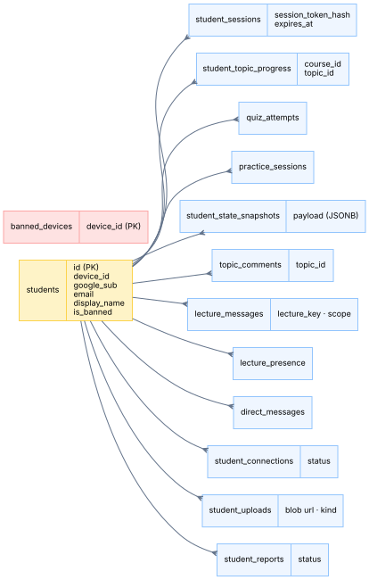

Indexes speed up the most frequent queries: progress by student and course, attempts and sessions by student and time, comments by topic and time, messages by lecture and scope, uploads by student and kind, sessions by student and expiry, reports by target and status.

# 23. Sign-in and sessions

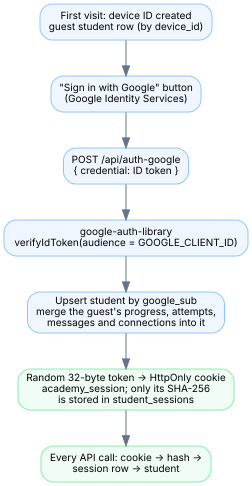

1. **Guest.** `shared.js` creates `deviceId` with `crypto.randomUUID()`. The first sync creates a `students` row for it.
2. **Button.** Google Identity Services is initialised with the client ID from `/api/app-config` and renders the standard button.
3. **Token.** Google returns an ID token (a signed JWT) to the page, which posts it to `/api/auth-google`.
4. **Verify.** `OAuth2Client.verifyIdToken({ idToken, audience: GOOGLE_CLIENT_ID })` checks signature, issuer, expiry and audience. Only the verified contents of the token are used: `sub`, `email`, `name`, `picture`.
5. **Create or update, then merge.** The student is found by `google_sub` (or email). If a different guest row exists for this device, its progress, drafts, attempts, sessions, watch events, presence, chat, comments and connections are moved to the account, removing duplicates and self-connections. Each step has its own `try`, so a missing table in an older database cannot abort the merge.
6. **Session.** A 32-byte random token is set as the cookie `academy_session` (`HttpOnly; Secure; SameSite=Lax; Path=/; Max-Age` 30 days). The database stores only `sha256(token)`, with an expiry and a revocation time.
7. **Every request.** `getStudentFromSession` reads the cookie, hashes it, and joins the session to the student, checking expiry and bans.
8. **Logout.** `/api/auth-logout` deletes the session row and expires the cookie.

# 24. Uploads

1. The page calls `upload()` from `@vercel/blob/client` with `handleUploadUrl: '/api/blob-upload'`.
2. `onBeforeGenerateToken` on the server requires a signed-in, non-banned student and returns the allowed types: JPEG, PNG and WebP for avatars; PDF, PPT and PPTX for study files. It adds a random suffix and embeds `{ deviceId, studentId, uploadKind, title, … }` in the token payload.
3. The browser uploads directly to Blob storage; the file never passes through the function.
4. `onUploadCompleted` records the file in `student_uploads`. For PDFs it runs the keyword check: it downloads the file, extracts text with `pdf-parse`, and matches a per-subject keyword list (generic list otherwise). A score of 45% or more is tagged *likely correct*, less is *needs review*, and failures are tagged *error*.

The Blob client and server packages must be the same version; a mismatch breaks browser uploads (fixed in PR #2).

# 25. Moderation and the admin dashboard

`/admin` (`admin/index.html`, `admin/admin.js`) shows totals (students, banned devices, open reports, uploads, chat, comments), lists students, reports, uploads, banned devices and recent chat, and offers these actions through `POST /api/admin`:

| Action | Effect |
|---|---|
| `ban-student` / `unban-student` | Set `is_banned` and record or clear the device in `banned_devices` |
| `ban-device` / `unban-device` | Ban a guest device directly |
| `resolve-report` / `dismiss-report` | Close a report |
| `delete-upload` | Remove an upload record |
| `delete-chat` | Remove a lecture message |

## Admin authentication (v2.2.1)

`authenticateAdmin` allows access in two ways:

1. **Google session.** The signed-in student's email is in the admin set: the built-in list in `api/_lib/admin-auth.js` plus `ADMIN_EMAILS`.
2. **Shared secret.** The `x-admin-secret` header matches `ADMIN_SECRET`, compared with `crypto.timingSafeEqual`. The secret is enabled only if `ADMIN_SECRET` has at least 12 characters. When no database is configured (mock store), the development secret `admin123` is accepted. The secret is never read from the URL.

Before 2.2.1, the literal strings `admin123` and `admin` were accepted even in production, and the secret could be passed as `?secret=`. **Any deployment older than 2.2.1 should set a strong `ADMIN_SECRET` and redeploy.**

# 26. Security and privacy summary

| Area | Measure |
|---|---|
| SQL injection | All queries are tagged templates with bound parameters |
| Sessions | Random 256-bit tokens; HttpOnly, Secure, SameSite=Lax; only hashes stored |
| Sign-in | Google ID tokens verified server-side for this client ID; no passwords; no extra scopes |
| XSS | User text is escaped with `escapeHtml` / `escapeForAttribute` before insertion; generated content contains no user input |
| Uploads | Signed-in only; type allowlist; random names; direct-to-Blob |
| Abuse | Rate limits per route; reports; student and device bans |
| Admin | Google allowlist or a strong header secret (constant-time compare) |
| Privacy | No ads or trackers; guest mode needs no data; YouTube in privacy-enhanced mode; full policy in `PRIVACY.md` |
| Android | No cleartext HTTP; only Internet and network-state permissions |

Known gaps worth closing: rate limits are per instance, the admin email list is in source code (move entirely to `ADMIN_EMAILS`), and there is no Content-Security-Policy header.

# Part VI — Apps, automation and quality {.part}

The Android and Windows apps, Docker, every workflow, and how changes are checked.

# 27. The Android app

::: {.callout data-title="In plain terms"}
The Android and Windows apps open the same Academy LMS website inside an app window, with their own icon and an animated opening screen. Each app also carries a copy of the study material, so notes and quizzes still open without internet. New versions are built automatically by GitHub whenever a release is published.
:::


## Project layout

```
android/
├── build.gradle                  AGP 8.11.1
├── settings.gradle, gradle.properties
└── app/
    ├── build.gradle              compileSdk/targetSdk 36, minSdk 24, signing from env
    └── src/main/
        ├── AndroidManifest.xml   INTERNET, ACCESS_NETWORK_STATE; icon, roundIcon; no cleartext
        ├── assets/site/          bundled site (generated at build time, git-ignored)
        ├── java/com/academy/lms/MainActivity.java
        └── res/                  mipmaps (icons), drawable-nodpi (splash logo), values(-v31) (themes)
```

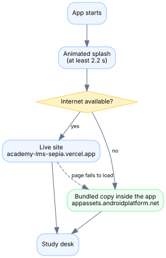

## `MainActivity`

| Concern | Implementation |
|---|---|
| Layout | `CoordinatorLayout` root → `SwipeRefreshLayout` → `WebView`; a thin horizontal `ProgressBar`; the splash layer on top |
| WebView | JavaScript, DOM storage and database enabled; wide viewport; no zoom; user agent suffixed `AcademyLMS-Android/1.0`; cookies and third-party cookies accepted (Google sign-in) |
| Links | Site, Vercel and Google sign-in URLs stay in the WebView; everything else opens in the system browser |
| Online | Loads `https://academy-lms-sepia.vercel.app/` |
| Offline | `WebViewAssetLoader` serves `assets/site/` at `https://appassets.androidplatform.net/assets/site/`; opened when there is no connection at start or the main frame fails to load; pull-to-refresh returns to the live site when online |
| Back | `OnBackPressedCallback`: `webView.goBack()` while possible, then leave the app (predictive back on Android 16) |
| Insets | Edge-to-edge: system bars, display cutout and keyboard insets applied as padding to the root; light status-bar icons on the dark background |
| State | `saveState` / `restoreState` across rotation |

## Splash animation

Built in code, so it is sharp on every density and can wait for the page:

1. A `FrameLayout` with a radial gradient (`#1B2150` → `#0B0F19`) covers the screen and swallows touches.
2. The emblem (`splash_logo.png`) animates from scale 0.55, rotation −8° and alpha 0 to full size in 800 ms with an `OvershootInterpolator`, then pulses between 1.0 and 1.06 forever.
3. *Academy LMS* (32 sp, bold, violet glow) and the tagline slide up 28 dp and fade in, starting at 450 ms and 700 ms.
4. A 140 dp cyan-to-violet bar sweeps from the left on repeat.
5. When the page finishes loading, and at least 2.2 s have passed, or after 7 s regardless, the layer fades and scales to 1.08 in 450 ms, the looping animators are cancelled, and the layer is removed.

On Android 12 and later, the system splash (`values-v31/styles.xml`: `windowSplashScreenAnimatedIcon`) shows the emblem first. On older versions the window background (`drawable/splash_window.xml`) does the same.

## Icons

Adaptive icons (`mipmap-anydpi-v26/ic_launcher.xml`): background colour `#0B0F19`, foreground the transparent emblem at 108–432 px; legacy square and round PNGs at 48–192 px. Generated from `assets/images/logo.png`: the emblem is cropped and its dark background is turned into transparency by a brightness key, so the glow fades rather than sitting in a box.

## Building

```bash
node scripts/bundle-android-site.js     # copy the site into app/src/main/assets/site (skips PDFs)
cd android && gradle assembleDebug       # or assembleRelease / bundleRelease with signing env
```

Signing reads `ANDROID_KEYSTORE_PATH`, `ANDROID_KEYSTORE_PASSWORD`, `ANDROID_KEY_ALIAS` and `ANDROID_KEY_PASSWORD`. Without them, release builds are unsigned and CI falls back to a debug APK.

# 28. The Windows app

```
desktop/
├── package.json        electron 33, electron-builder 25, build config
├── main.js             splash window, main window, offline fallback
├── splash.html         animated splash (CSS only)
├── splash-logo.png
├── bundle-site.js      copies index.html, html/, js/, assets/, admin/ into desktop/site
└── build/icon.png, icon.ico
```

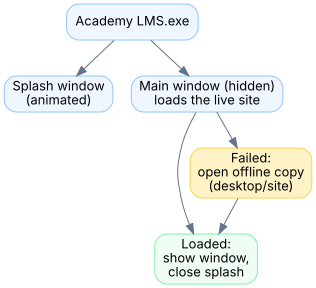

`main.js`:

1. Creates the splash: 460×400, frameless, transparent, always on top, not in the taskbar; shows it on `ready-to-show`.
2. Creates the main window hidden (1400×900, minimum 960×640, the emblem as its icon, no menu bar, context isolation and sandbox on) and loads the live site.
3. On `did-finish-load`, or after 8 s, waits until 2.2 s have passed since the splash appeared, shows the main window and destroys the splash.
4. On a main-frame `did-fail-load` (except aborts), loads `site/index.html?view=study` from disk, which is the offline copy.
5. Sends `window.open` links with `http(s)` to the default browser.

`splash.html` animates purely in CSS: the card scales in, a halo pulses, the logo pops in with a cubic-bezier overshoot and then floats, the title and tagline rise in sequence, and a gradient bar sweeps. It honours `prefers-reduced-motion`.

electron-builder targets: **NSIS** (`Academy-LMS-Setup-<version>.exe`: choose folder, desktop and Start menu shortcuts, custom installer and uninstaller icons) and **portable** (`Academy-LMS-Portable-<version>.exe`). `npm run dist:win` runs `bundle-site` first.

# 29. Workflows

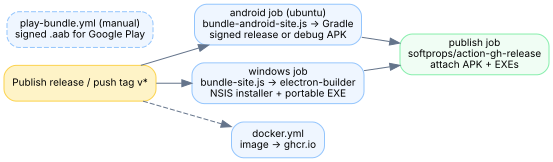


| Workflow | Trigger | What it does |
|---|---|---|
| `release.yml` | tag `v*` (e.g. publishing a release), or manual with a tag | **android**: bundle site, Gradle, signed release APK if secrets exist else debug · **windows**: set version from tag, `npm run dist:win` · **publish**: attach `Academy-LMS-<tag>.apk` and both EXEs to the release (softprops/action-gh-release) |
| `build-apk.yml` | push to `main` or PR touching `android/**` | Builds the APK to catch breakage; uploads it as an artifact; never publishes |
| `play-bundle.yml` | manual | Signed `.aab` for Google Play (fails clearly if secrets are missing) |
| `docker.yml` | push to `main`, tags, PRs | Builds the image; pushes to `ghcr.io/<owner>/academy-lms` on `main` and tags |
| `curriculum.yml` | changes to `scripts/**`, `js/data*.js`, `js/resource-library.js` | `npm run build:curriculum`; fails if `git diff` shows changes; `node --check` every data file |
| `static-site-checks.yml` | push to `main`, PRs | htmlhint on every page, `node --check` on `js/`, `prettier --check` |
| `link-check.yml` | weekly (Monday 04:00 UTC), manual | lychee checks links in the repository |
| `organize-resources.yml` | push to `main`, manual | Sorts `incoming_resources/` and commits the result |

## Cutting a release

1. Update `version` in `package.json`, `desktop/package.json`, and `versionCode` + `versionName` in `android/app/build.gradle`; add a `CHANGELOG.md` entry.
2. Merge to `main`.
3. On GitHub, open *Releases → Draft a new release*, type a new tag (`v2.2.1`), target `main`, and publish. Creating the tag starts `release.yml`.
4. After about 15 minutes, the release has the APK, the installer and the portable EXE under *Assets*.

## Secrets

| Secret | Used by |
|---|---|
| `ANDROID_KEYSTORE_BASE64`, `ANDROID_KEYSTORE_PASSWORD`, `ANDROID_KEY_ALIAS`, `ANDROID_KEY_PASSWORD` | `release.yml` (signed APK), `play-bundle.yml` |
| `GITHUB_TOKEN` (automatic) | publishing releases, pushing to GHCR, the organiser's commits |

# 30. Testing and quality

## What runs today

| Check | Where | Catches |
|---|---|---|
| `node --check` on the server, every API file, every page script and the generators (`npm run check:js`) | local; `static-site-checks.yml` for `js/` | Syntax errors |
| Generator validation | `build_multibranch_curriculum.js` | Bad curriculum lines, unknown IDs, unused subjects, missing references |
| Staleness check | `curriculum.yml` | Generated files out of sync with their sources |
| htmlhint | `static-site-checks.yml` | Malformed HTML, duplicate IDs, unclosed tags |
| Android build | `build-apk.yml` on PRs | Java and resource errors |
| Docker build | `docker.yml` on PRs | Broken image |
| Link check | `link-check.yml` weekly | Dead links in docs and content |
| Headless-browser walkthrough | run by hand with Playwright before each v2 release | JavaScript errors across picker → desk → browse → back → tests → resources → lectures → profile; offline bundle; splash rendering |

## Known gaps

- **`prettier --check` currently fails.** `static-site-checks.yml` checks formatting of every HTML, CSS, JS, Markdown, YAML and JSON file, and about 700 files, mostly generated curriculum and older hand-written files, are not Prettier-formatted, so the workflow is red on every push. The options are to format the hand-written files once and add a `.prettierignore` for generated output, or to drop formatting from CI. This is a decision for the maintainers.
- **No unit tests.** The generator's parser, the seeded quiz builder, the programme API (`getPlanEntries`, `findPlacement`) and `calculateStats` are pure functions and should have unit tests.
- **The browser walkthrough is not in CI.** A Playwright smoke test against `npm start` would catch most regressions in the pages.
- **The schema is not tested.** A CI job that applies `docs/academy_schema.sql` to a throwaway Postgres would have caught the missing `banned_devices` table, which was added to the schema in 2.2.1.

# 31. Performance

| Technique | Where |
|---|---|
| Content split per subject, loaded on demand | `loadCourseData`, `loadCourseScripts` |
| Preload only the current view's subjects | `preloadRemainingCourses` |
| Mermaid loaded only when a topic has a diagram | `app.js` |
| Prefetch pages on link hover | `initInstantPrefetch` in `shared.js` |
| Config and session cached per tab, revalidated in background | `sessionStorage` |
| Tailwind purged and minified | `npm run build:tailwind` |
| gzip | `compression` in `server.js`; Vercel compresses automatically |
| Lazy iframes | lecture player `loading="lazy"` |
| Debounced cloud sync | 2.2 s / 9 s / 12 s gap |

# Appendix A — Environment variables {.unnumbered}

| Variable | Where | Required | Purpose |
|---|---|---|---|
| `DATABASE_URL` (or `POSTGRES_URL`, `STORAGE_URL`) | Vercel, `.env` | For persistence | Neon connection string; without it the mock store is used |
| `GOOGLE_CLIENT_ID` | Vercel, `.env` | No (built-in default) | OAuth client for Google sign-in |
| `ADMIN_SECRET` | Vercel, `.env` | Recommended | Admin dashboard secret, 12+ characters, sent as `x-admin-secret` |
| `ADMIN_EMAILS` | Vercel, `.env` | No | Comma-separated extra admin emails |
| `BLOB_READ_WRITE_TOKEN` | Vercel | For uploads | Vercel Blob store token |
| `PORT` | `.env`, Docker | No | Server port (default 3000) |
| `ACADEMY_URL` | Windows app | No | Override the site the desktop app loads |
| `ANDROID_KEYSTORE_*`, `ANDROID_KEY_*` | GitHub secrets, local env | For signed Android builds | See Chapter 29 |

# Appendix B — npm scripts {.unnumbered}

| Script | Command | Use |
|---|---|---|
| `npm start` / `npm run dev` | `node server.js` | Local server on port 3000 |
| `npm run build` / `build:tailwind` | Tailwind CLI | Rebuild `assets/css/tailwind.css` |
| `npm run build:curriculum` | both generators | Regenerate subjects, data block, PDFs and manifest |
| `npm run check:js` / `lint` | `node --check …` | Syntax-check server, API, pages and scripts |
| `npm run bundle:android` | `scripts/bundle-android-site.js` | Copy the site into the Android app |
| `npm run docker:build` / `docker:run` | Docker | Build and run the image |
| `desktop/`: `npm start`, `npm run dist:win` | Electron | Run the Windows app; build installer and portable EXE |
| `python3 tools/docs/build_docs.py` | pandoc + Chromium | Rebuild `JOURNEY.pdf` and this guide |

# Appendix C — Troubleshooting {.unnumbered}

**"Database URL missing — using in-memory mock store."** Expected locally without `.env`. Set `DATABASE_URL` for persistence.

**Sign-in button does nothing / "origin not allowed".** Add the site's origin (for example `http://localhost:3000`) to the OAuth client's authorised JavaScript origins in Google Cloud.

**Uploads fail in the browser.** Check `BLOB_READ_WRITE_TOKEN` and that `@vercel/blob` has one version in `package-lock.json`.

**New Tailwind classes have no effect.** Run `npm run build:tailwind`; make sure the class name appears whole in a scanned file.

**`curriculum.yml` fails with a diff.** Run `npm run build:curriculum` and commit everything it changed.

**`Term without " = "` when building.** A topic line has a field with no ` = `, often because a `|` appeared inside text. The error names the file and line.

**Admin dashboard says "Authentication required".** Sign in with an admin Google account, or set `ADMIN_SECRET` (12+ characters) and type it into the dashboard. `admin123` works only without a database.

**Device bans fail with "relation banned_devices does not exist".** Re-run `docs/academy_schema.sql` (2.2.1 adds the table).

**Android app shows the offline copy while online.** Pull down to refresh; the app returns to the live site when the main page loads.

**Windows SmartScreen warns about the EXE.** The build is not code-signed. Choose *More info → Run anyway*; signing is on the roadmap.

# Appendix D — Glossary {.unnumbered}

See *Academy LMS: The Journey*, Appendix C. Additional terms used here:

**AGP.** Android Gradle Plugin, which builds Android apps with Gradle.

**GHCR.** GitHub Container Registry, where the Docker image is published.

**Marked block.** A file region between `<<…:START>>` and `<<…:END>>` owned by a generator.

**NSIS.** Nullsoft Scriptable Install System, used for the Windows installer.

**Tagged template.** A JavaScript template literal passed to a function (`` sql`…` ``), used to build parameterised SQL.
